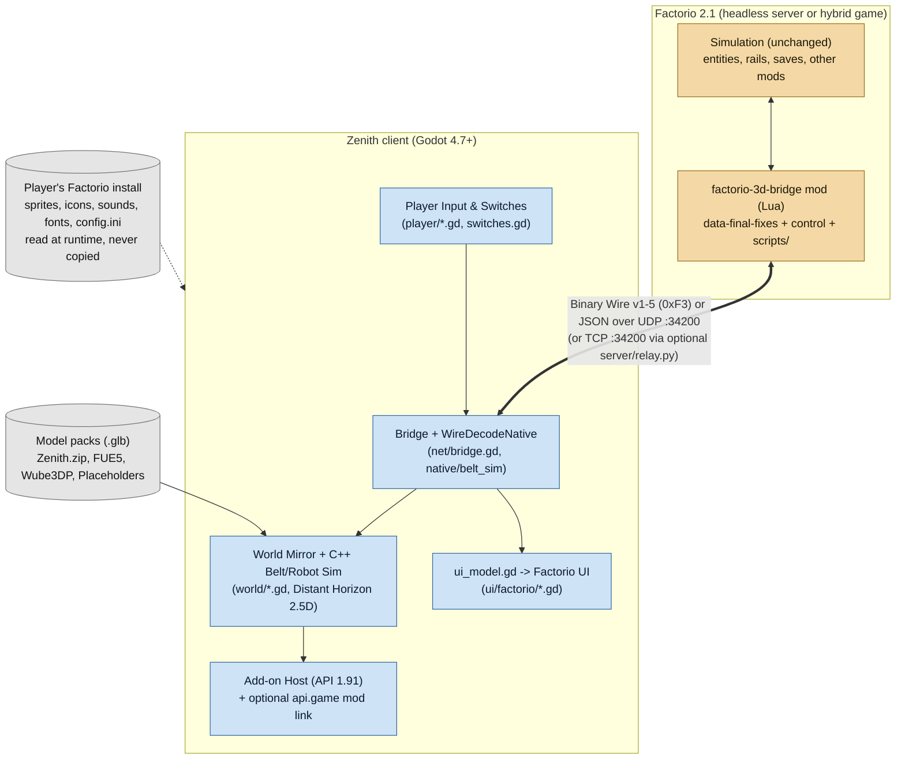
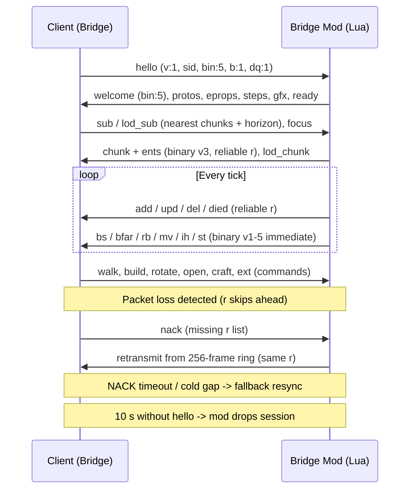
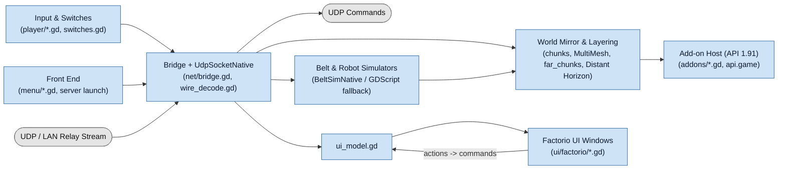
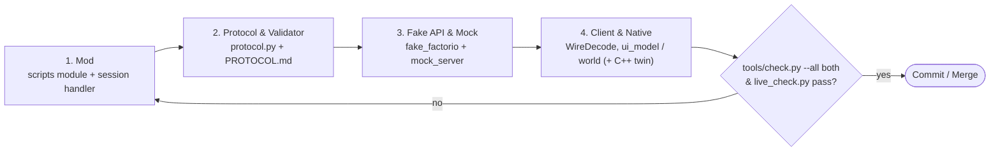

# Architecture

How Zenith's pieces fit together for anyone reading or forking the codebase. Setup lives in [docs/RUNNING.md](docs/RUNNING.md), contributor rules in [CONTRIBUTING.md](CONTRIBUTING.md), tests in [docs/COMMANDS-TESTS.md](docs/COMMANDS-TESTS.md), and every wire field in [docs/PROTOCOL.md](docs/PROTOCOL.md).

## System overview

Factorio stays the authoritative simulation. Mods have no access to Factorio's 2D renderer, so Factorio runs headless (or windowed in hybrid mode) while the `factorio-3d-bridge` Lua mod exchanges state and commands with a standalone Godot 4.7+ client over Factorio 2.x's local UDP API (`helpers.send_udp` / `recv_udp`, `--enable-lua-udp`).

## The bridge mod (`mod/factorio-3d-bridge/`)

- **Data stage (`data.lua`, `data-final-fixes.lua`):** Adds the `"Show in Zenith"` (`Ctrl+F9`) custom input and packs non-destructive mod metadata (`zenith-step-sounds` tile footsteps and `gfx` mod sprites/icons/tiles) into `mod-data` prototypes for runtime streaming.
- **Modular tick loop (`control.lua`, `scripts/*.lua`):** Dispatches game events and runs module ticks in fixed order; `profile.lua` instruments script cost (`/f3d-profile`, `/f3d-status`).
- **Determinism:** `storage.f3d` mutates strictly in events and `on_tick` so multiplayer peers never desync. Only prototype-derived read caches live at module level (`registry.lua`); UDP sends happen without altering simulation state.
- **Character & takeover (`puppet.lua`, `takeover.lua`):** Drives a player-less character (mining, building with `raise_built`, inventories, quickbar, alerts), seamlessly handing items and state back and forth when real players log into the server.
- **Chunk & state streaming:** Streams `32x32` chunk snapshots (`world.lua`, `world_chunk.lua`) and far `lod_chunk` tiles, plus event deltas (`tracker.lua`) and focus-radius polls (movers, inserters, fluids, power, machines).
- **Client-driven belt & robot sims (`belt_sim*.lua`, `robots.lua`):** Instead of resending every item every tick, the mod sends lane deltas, splitter crossing hints (`sx`), and robot schedules (`rb`), letting the client predict motion smoothly between ticks.
- **Budgets & adaptive rates (`budget.lua`, `rate.lua`):** Large requests (chunks, map view, trains, Factoriopedia, Distant Horizon) slice cleanly under a per-tick work-unit cap; `rate` levels `0–3` slow costly polls first under server load.
- **Reliability & recovery (`transport.lua`):** Reliable packets carry monotonic sequence `r` and are retained in a `256`-frame retransmit ring for low-latency `nack` recovery; older gaps fall back to chunk `resync`. Bad incoming packets are isolated inside `pcall` (`session.on_packet`).
- **Multi-client & add-on link (`session.lua`, `link.lua`):** Swaps per-client state in `storage.f3d_extra` (up to 8 clients) and relays `ext` messages between GDScript add-ons (`api.game`) and companion Factorio mods.

## Wire protocol & recovery

Payloads run over localhost UDP (or LAN TCP frames `ZRL1`/`ZRC1` via `server/relay.py`). Positions use signed integers in **`1/256` tile**; batches combine messages up to `60 KB` (`b: 1`), tracked with datagram counters (`dq: 1`). Binary frames (`0xF3`, wire `v1–5`) pack hot streams (`mv`, `bs`, `bfar`, `chunk`, `ents`, `st`, `ih`, `rb`, and `sx` splitter hints) in little-endian binary to avoid JSON text overhead. Protocol changes must stay in lockstep across five places: mod, client, `tools/mock_server.py`, `tools/protocol.py`, and [docs/PROTOCOL.md](docs/PROTOCOL.md).

## The client (`client/`)

- **Networking & C++ native twin (`scripts/net/`, `native/belt_sim/`):** `Bridge` decodes UDP/relay frames via `WireDecodeNative` / `UdpSocketNative` (`native/belt_sim/` registers 13 C++ GDExtension classes: `BeltSimNative`, `BeltDrawNative`, `BeltItemsNative`, `BeltLatticeNative`, `BeltMvNative`, `MoversNative`, `InserterArmsNative`, `ChunkBuildNative`, `LodMesherNative`, `DecorNative`, `TerrainFieldNative`, `WireDecodeNative`, and `UdpSocketNative`). Every native path falls back cleanly to GDScript when absent or disabled via [SWITCHES.md](docs/SWITCHES.md).
- **World rendering (`scripts/world/`):** Draws `MultiMeshInstance3D` batches per chunk per mesh (never one node per belt), worker-threaded `.glb` imports (`model_library.gd`), GPU-driven animations/robots/creatures (`anim.gd`, `mover_records.gd`, `robot_swarm.gd`), far chunk merging (`far_chunks.gd`), **Distant Horizon** 2.5D terrain/silhouettes (`lod_horizon`), and view-fitted sun shadows (`sun_shadows.gd`).
- **Model packs & graphics (`model_packs.gd`, `mod_graphics.gd`):** Resolves stacked packs (**Zenith.zip**, **FUE5**, **Wube3DP**, **Placeholders**, **Factorio** 2D cutouts + user folders/zips), per-pack PBR vs Factorio sprite balance, and runtime-extracted icons/tiles/sprite cards for external Factorio mods.
- **UPS & frame pacing (`ups_governor.gd`):** Adapts `rate` levels, bridge `budget`, distances, and FPS cap automatically to preserve `60 UPS` on slow ticks without overwriting saved settings.
- **CLI switches & UI (`switches.gd`, `scripts/ui/factorio/`):** `Switches` centralizes all CLI flags (`--*`); `ui_model.gd` decouples bridge state/commands from Factorio UI windows; `menu/*.gd` handles server lifecycle, Factorio `config.ini` defaults sync, and `Settings.dev_tools()` gating.
- **Add-on runtime (`scripts/addons/`):** Runs sandbox-switched user add-ons against versioned **API `1.91`** (camera, keys, settings, custom UI, read-only world, events, shaders, terrain, weather, audio, creatures, storage, and `api.game` mod messaging).

## Testing & verification pipeline

Run [tools/check.py](tools/check.py) to run only checks matching modified files vs `main`, or run full CI suites (`--all fast`, `--all godot`, `--all both`). See [docs/COMMANDS-TESTS.md](docs/COMMANDS-TESTS.md) for the complete command table.

| Check | What it verifies | Environment |
|---|---|---|
| `tools/mod_tests/test_bridge.py` + `--binary` | Split bridge suites (`01..09`) in Lua 5.2 against strict `fake_factorio.lua` (JSON + Binary v1–5) | Python, `lupa` |
| `tools/mod_tests/test_{fuzz,binary,data_stage}.py` | Packet fuzzing, binary vs JSON parity, mod `gfx` data stage | Python, `lupa` |
| `tools/test_{mock_server,mock_fuzz,relay,events,protocol_sync}.py` | Mock UDP server, fuzzing, TCP relay reconnects, protocol & table sync | Python |
| `tools/test_{check,code_health,safe_delete}.py` + `gdparse` | `check.py` area map & `SECTION_ORDER`, code health metrics, Windows junction-safe deletes, GDScript parse | Python, `gdtoolkit` |
| `tools/models/check.py` + `tools/release/leak_scan.py` | `.glb` footprints, origins, poly budgets; zero leaked credentials or local paths | Python |
| `client/tests/ui_test.tscn`, `addon_test.tscn`, `switches_test.gd` | Split UI suites (`16` area modules), add-on API `1.91` (`4` area modules), CLI `Switches` registry | Godot 4.7+ |
| `client/tests/belt_sim_native_test.gd`, `wire_decode_native_test.gd` | Step-for-step C++ GDExtension parity vs GDScript | Godot 4.7+ |
| `client/tests/{model_load,mod_files,model_packs,decor,vr}_test` | Model worker loads, mod file indexing, pack layering, decoratives, VR panel | Godot 4.7+ |
| `tools/live_check.py` + `tools/busy_base.py --big --measure` | Modular live suite (`tools/live/*.py`) & UPS perf budget against real Factorio headless | Running Factorio 2.1 |

## Adding a feature

1. **Mod:** Implement in a `scripts/*.lua` module, wire `session.lua` / `control.lua`, and register any new Factorio API keys in `fake_factorio.lua`.
2. **Protocol:** Update sender, client decoder, `tools/mock_server.py`, `tools/protocol.py`, and [docs/PROTOCOL.md](docs/PROTOCOL.md) together.
3. **Client & native parity:** Route data/commands through `ui_model.gd`, register new flags in `switches.gd`, and update matching C++ files in `client/native/belt_sim/src/` if touching belts/decoders/movers.
4. **Verify:** Run `python tools/check.py --done` (plus `live_check.py` and `leak_scan.py` as needed).
