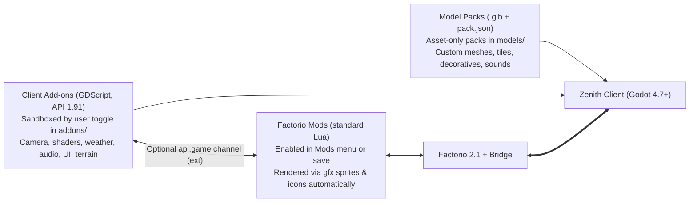

# Modding and Add-ons

Zenith renders whatever real Factorio runs underneath, while offering safe, layered extension points for 3D models, client add-ons, and companion Factorio mods.

- **Code changes to Zenith itself** require a fork under GPL-3.0 ([CONTRIBUTING.md](CONTRIBUTING.md); the main repo does not accept pull requests).
- **Client add-ons** use versioned **API `1.91`** ([docs/ADDONS.md](docs/ADDONS.md)); companion Factorio mods can exchange messages with an add-on via `api.game` (worked example: `addons-src/sprint/`).

## What works today

| You want to… | How | Status |
|---|---|---|
| Add or override a 3D entity/item model | Place `<prototype>.glb` in a model pack (`models/` or `--models=<dir>`) | Works |
| Override ground tiles, decoratives, or sounds | Add `tiles/`, `decoratives/`, or `sounds/` inside a model pack | Works |
| Enable per-pack PBR materials & textures | Set `"shading": "pbr"` in `pack.json` and embed glTF textures | Works |
| Add moving parts to a model | Name child objects `anim_*` or export one glTF skeletal action | Works |
| Add custom camera, shaders, weather, audio, terrain, or UI | Write a client add-on (`addon.json` + GDScript, **API `1.91`**) | Works |
| Play alongside Factorio content/overhaul mods | Enable in the menu's **Mods** window; `gfx` draws sprites, icons & tiles | Works *(custom mod GUIs stay in Factorio `Ctrl+F9` by default)* |

## Adding a 3D model

See [docs/MODELLERS.md](docs/MODELLERS.md) for the modeller workflow and [client/assets/models/README.md](client/assets/models/README.md) for complete tables.

Entities are matched by Factorio internal **prototype name** (e.g. `assembling-machine-2`). Packs resolve top-to-bottom in the **Model packs** window:

- **User & downloaded packs (`models/` or `--models=<folder>`):** `.zip` packs, folders, or loose `.glb` files placed in `models/` load above built-in packs by default. Pass `--models=<folder> --models-first` on CLI to test an external folder above everything.
- **Built-in packs:** **Vasillo's Zenith pack** (`models/Zenith.zip`, when bundled), **FUE5 (Adapted)** (`packs/fue5/`), **Wube3DP (Adapted)** (`packs/wube3dp/`), **Placeholders** (`packs/placeholders/`), and **Factorio** (runtime 2D sprite cutouts).

### Model requirements

- **Format & scale:** Binary glTF `.glb` (Blender `+Y` up), **1 unit = 1 tile**, origin centered on footprint at ground level, facing north (`+Y` Blender / `-Z` Godot) for rotatable entities or south for non-rotating ones.
- **Mesh & materials:** Static geometry flattens per pack/model; optional base-colour, metallic-roughness, occlusion, normal, and emission maps are read from embedded textures (`MATERIAL_CLASSES` in `model_library.gd` controls weathering; `"shading": "pbr"` opts into full PBR).
- **Motion:** Either separate `anim_*` child objects (pivoted at their origin: `anim_spin_*`, `anim_glow_*`, `anim_turret_head`, `anim_door_*`, `anim_hatch_*`, `anim_lit_*`, `CYCLES`) or a single baked skeletal glTF animation loop.
- **Variants:** Multi-piece/direction kits follow Factorio naming (`-curve-left`, `-input`/`-output`, `pipe-<shape>`, `-east`/`-south`/`-west`, numbered clutter `<name>-1`, `-2`, ...). See [client/assets/models/README.md#variants](client/assets/models/README.md#variants).
- **Validation:** `python3 tools/models/check.py <name>` validates naming, footprint, origin, facing, and triangle budgets.

## Playing with other Factorio mods

Enable mods in the main menu's **Mods** window (or tick **Sync mods with save** when loading a save):

- **Simulation & prototype graphics (`gfx`):** Factorio runs every mod natively. The bridge's `data-final-fixes.lua` extracts mod item icons, entity sprites, terrain tiles, decoratives, and tile step sounds into `gfx` so modded items and buildings appear with their real art on camera-facing sprite cards (optionally animated via **Animate modded buildings**, falling back to map-coloured boxes only if no picture exists).
- **Mod GUIs:** Custom mod windows are disabled by default (`Settings → Interface → Show mods' windows`); press **`Ctrl+F9`** to use them directly in Factorio's window (`Informatron` buttons and hybrid-mode auto-clicking on Windows are also supported).
- **Player vs. script events:** On headless servers without a logged-in human player, the bridge builds by script (`script_raised_built`). In hybrid mode or when playing as a configured player with **Act as the player for other mods** enabled, Factorio raises normal player build/mine/rotate events and applies player reach bonuses.
- **Overhaul coverage:** Small/medium mods and asset packs like Space Exploration's graphics work; large UI-heavy overhauls need wider play-testing and bug reports.

## Where modding is going

1. **Mod-bundled 3D packs:** Metadata manifests allowing Factorio mods or companion packs to bind automatically to specific mod names and versions.
2. **Broader animation & reactive bindings:** Additional `anim_*` targets driven by active recipes, fluid levels, and circuit signals.
3. **Custom mod UI & particle hooks:** Richer in-client handling of mod GUIs plus particle/effect hooks for add-ons and modded machines.
4. **Overhaul mod validation:** Compatibility fixes driven by player testing on major overhauls.
