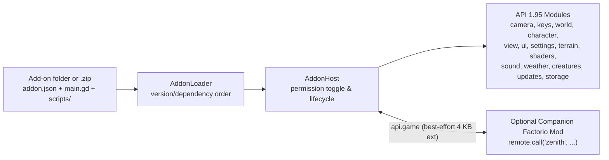

# Writing add-ons for Zenith

An add-on is a GDScript program running inside Zenith that extends the camera, visuals, UI, weather, terrain, or sound via the versioned add-on API (**API `1.95`**).

> **Contents:** [Architecture](#architecture) · [Installing](#installing-an-add-on) · [Folder & dependencies](#the-folder) · [Entry script](#the-entry-script) · [The API](#the-api) · [Factorio mod link (`api.game`)](#messages-to-your-factorio-mod) · [Testing & errors](#testing)

## Architecture



- **Security model:** Add-ons execute normal GDScript with your OS user permissions (files, processes, network). New third-party add-ons always start **off** until explicitly enabled in the **Add-ons** menu. Model/icon/tile packs are pure asset data and cannot execute code.
- **Simulation separation:** Add-ons cannot mutate Factorio's world directly. Gameplay changes must pair your add-on with a Factorio mod and exchange messages through `api.game` (see [`addons-src/sprint/`](../addons-src/sprint) and the `4` in-repo examples under `addons-src/`: `cinematic-shaders`, `immersive-weather`, `immersive-enemies`, `sprint`).
- **Worked camera/recording reference:** [Zenith-Cinematic-Camera](https://github.com/unjustodin/Zenith-Cinematic-Camera) demonstrates free camera, paths, and async `SubViewport` recording (`UPDATE_ONCE` + `RenderingDevice.texture_get_data_async` + worker AVI encoding).

## Installing an add-on

Place an add-on folder (containing `addon.json`) or an uncompressed/compressed `.zip` (`addon.json` at root or one subfolder deep, unpacked on change to `user://addons-cache/<id>/`) in:

| Location | Use |
|---|---|
| `%APPDATA%\Godot\app_userdata\Zenith\addons\` (Win) / `~/.local/share/godot/app_userdata/Zenith/addons/` (Linux) | Player add-ons (kept across updates) |
| `addons\` beside `Zenith.exe` | Add-ons bundled with a release |
| `--addons=<dir>` *(comma-separated for multiple)* | Active development — always loads enabled and overrides installed copies |

- **Precedence & state:** Duplicate `id`s resolve to highest semantic version (`--addons` always wins, then folders beat zips on ties). New add-ons start off (`--addons-default=on` starts them enabled); bundled defaults are seeded once by `addons/bundled.json` (releases ship **Cinematic camera**, **Cinematic shaders**, **Immersive Weather**, **Immersive Enemies** and **Terrain Elevation**, all on).
- **In-game UI:** Manage switches, per-add-on settings (`api.settings`), custom controls (`api.ui.set_options`), and rebindable keys under **Add-ons** (main menu / Esc menu) and **Settings → Controls**.

## The folder

Zip `my-addon/` (`my-addon_<version>.zip`) containing `addon.json`, `main.gd`, and helper scripts:

```json
{
	"id": "my-addon",
	"name": "My add-on",
	"version": "1.0.0",
	"api": 1.91,
	"entry": "main.gd",
	"author": "you",
	"description": "One line for the Mods window."
}
```

| Field | Purpose |
|---|---|
| `id` | Lowercase `a-z`, `0-9`, `-`, `_` (`:` forbidden). Keys actions, `api.storage` folder, and node names. |
| `name`, `version`, `description`, `author` | Displayed in the Add-ons menu, Mods window, and Settings → Controls. |
| `api` | Minimum required API level (`1`, `1.1`..`1.9`, or `1.91`..`1.95`; note numeric levels: `1.91` follows `1.9`). Zenith refuses add-ons requiring a newer level. |
| `entry` | Path to the entry `.gd` script inside the add-on folder. |
| `dependencies` | *(1.7)* Optional array of required/optional/incompatible add-ons and `mod:<name>` Factorio mods. |

Compatibility note: target `"api": 1` and guard newer features via `api.get("level") != null and api.level >= 1.7` if supporting older Zenith builds.

### Dependencies *(1.7)*

```json
"dependencies": ["cinematic-camera >= 0.3.0", "? terrain-elevation", "mod:space-age >= 2.1.0", "! old-camera"]
```

Format `"<prefix><name> <op> <version>"` (`op`: `<`, `<=`, `=`, `>=`, `>`; bare name = add-on id, `mod:<name>` = Factorio mod without spaces):

| Prefix | Rule |
|---|---|
| *(none)* | Required — must be installed, enabled, and version-matched; starts before dependent add-on. |
| `?` / `(?)` | Optional — ignored if missing/disabled; if present & enabled, version must match and starts first (`(?)` hides from UI page). |
| `!` | Incompatible — never runs alongside target; running add-on/game mod takes priority. |
| `~` | Required without ordering constraint (allows mutually dependent add-ons). |
| `+` | Treated as optional. |

- **Add-on checks:** Resolved at start-up/reload in topological depth order (cycles refused). Zenith never auto-enables dependencies; disabling or reloading an add-on stops/reloads dependents cleanly.
- **Factorio mod checks:** Checked on joining a game; unsatisfied `mod:<name>` deps suspend the add-on only during that game and resume in the menu. Query optional versions via `api.addons.version(id)` *(1.7)* and `api.game.mod(name)`. `--addon-requires=off` bypasses dependency checks for debugging.

## The entry script

The entry script extends `Node`. Zenith adds it to the scene when the add-on starts and calls
`addon_start(api)`; when the player switches the add-on off it calls `addon_stop()` (if there is
one) and frees the node. Everything set up through the API (the camera, keys, windows, requests)
is undone by Zenith then, so `addon_stop` only needs to save the add-on's own state.

```gdscript
extends Node

var api


func addon_start(a) -> void:
	api = a
	api.keys.add("hello", "Say hello", [KEY_F10])


func _unhandled_input(event: InputEvent) -> void:
	if api.keys.pressed(event, "hello"):
		var me: Dictionary = api.world.character()
		api.ui.message("Hello from %s" % str(me.get("position", "the menu")))
```

The node gets `_process`, `_input` and `_unhandled_input` as any node does, and gets input before
Zenith's own controls and menus. Add-ons start at Zenith's start-up, before any game: listen to
`api.game_started` and `api.game_ended`, and check `api.in_game()`.

A few GDScript notes:

- Don't use `class_name`: scripts loaded from outside Zenith's own project can't rely on Godot's
  global class list. Load your other scripts with a path relative to the script doing it
  (`const Orbit := preload("scripts/orbit.gd")`) or with `api.load_script("scripts/orbit.gd")`.
- Zenith's own scripts can be preloaded by their `res://` paths, but only the API below is
  promised to stay the same within an API version.
- Don't infer a type from a Variant (`var x := api.world.trains()` is an error): write the type
  (`var x: Array = ...`) or leave it out (`var x = ...`).

## The API

`api` has these parts. Positions are Godot's: `x` east and `z` south, in tiles, `y` up; Factorio's
`(x, y)` is `(x, z)` here and the ground is at `y = 0`.

| | |
|---|---|
| `api.version` | The add-on API this Zenith offers (1) |
| `api.level` | *(1.1)* The exact level, with the additions within the version (1.2). Absent on 1.0 |
| `api.zenith_version` | Zenith's version, for messages |
| `api.id`, `api.name`, `api.addon_version`, `api.dir` | From your `addon.json`, and the add-on's folder |
| `api.in_game()` | A game is on |
| `api.game_started`, `api.game_ended` | Signals |
| `api.native_class(name)` *(1.93)* | An instance of one of Zenith's native C++ classes for an add-on's hot loops (`BiterRagdollNative`, `BiterGoreNative`, `AcidGooNative`, `BiterAnimNative`; any other name gives null); null too where the native library is missing (Linux, macOS, ARM64) or with `--enemies-native=off`: keep your GDScript for null |
| `api.cue_changed(tick)` *(1.92)* | Signal: the game set a filmed scene's cue (a mod's `remote.call("zenith", "set_cue", tick)`), `-1` when it cleared it |
| `api.note(text)` | A line in Zenith's log, marked with the add-on's id |
| `api.load_script(path)` | One of the add-on's own scripts, by its path in its folder |
| `api.addons.version(id)` | *(1.7)* The version of the add-on with that id while it runs, `""` when it isn't (not installed, off, refused): for optional dependencies |

### Camera: `api.camera`

One add-on has the camera at a time. While it does, the player's own view (the angled view,
Factorio's view, first person, the zoom) is kept as it was, and comes back exactly so.

| | |
|---|---|
| `take(options = {})` | Takes the camera; false when it can't now (no game, another add-on has it, a ride to a space platform, VR). Options: `"input"` (default `true`: the player's controls are off and the character stops; your `"camera"` keys work), `"focus"` (`"camera"`, the default: the world loads round the ground in the middle of the picture; `"character"`: round the character), `"aim"` *(1.7)* (`"center"`: building, mining, the hover, Ctrl+clicks and shots aim at the middle of the screen through your camera, as first person does; only with `"input": false`, since with the player's controls off nothing aims; `"input"`'s default stays `true`) and `"crosshair"` *(1.7)* (default `true`: Zenith's dot in the middle while aiming at the centre). The mouse never turns the hidden first-person view while you have the camera |
| `release()` | Back to the player's view |
| `has()`, `has_input()` | Whether this add-on has it, and the player's controls are off |
| `node()` | The `Camera3D` itself while you have it (else null): set its `global_transform`, `fov`, `projection`, `size`, `near`, `far`, `attributes` (depth of field). All of it is put back on release |
| `set_transform(t)`, `look_from(eye, at)` | Where it is and where it looks |
| `transform()`, `fov()` | The camera now (also while the player has it: where to start a shot from) |
| `player_view()`, `player_fov()`, `player_orthographic()` | Where the player's own view would put the camera now: glide there before `release()` for a seamless hand-back |
| `set_focus(point)` | Where the world loads and live data is asked for (a `Vector2` in tiles), or `null` for take()'s choice |
| `focus()` | The point the world is loaded round now |
| `capture_mouse(on)`, `mouse_captured()` | The mouse hidden and captured (its motion arrives as `InputEventMouseMotion.relative`, for mouse look) while you have the camera; Zenith gives it back while a window or menu is open |
| `ground_point(screen_pos)`, `center_ground()` | The ground under a point of the screen, or its middle (`null` above the horizon) |
| `lost` | Signal: Zenith took the camera back (a ride to a platform started, the game ended) |
| `set_modifier(offset = Vector3.ZERO, turn = Vector3.ZERO, fov = 0.0)` *(1.7)* | A bob, a sway, a shake or a kick on top of the player's own view (the angled view, Factorio's view, first person), from the next frame until changed: `offset` in tiles in the camera's frame (`x` right, `y` up, `-z` forward), `turn` in radians (`x` pitch, `y` yaw, `z` roll) about the moved eye, `fov` degrees added to the view's own (ignored by orthographic views). Every add-on's modifier is added up, then capped: the offset at 1.5 tiles, pitch and yaw at 20 degrees, roll at 45, the FOV change at 30 either way and the result between 10 and 120; not-a-number counts as 0. No easing: set it each frame. Not drawn in a ride's film, the remote view, VR or while an add-on has the camera (kept, and drawn again after); `take()` keeps the player's view without it. Gone when your add-on stops or the game ends. `--camera-modifiers=off` turns them off for a run |
| `clear_modifier()` *(1.7)* | The same as `set_modifier()` |
| `modifier()` *(1.7)* | Your add-on's own modifier as set: `{offset, turn, fov}` (what you set, not what is drawn) |
| `mode()` *(1.7)* | What the camera is doing now, one of the modes below (`""` outside a game) |
| `player_mode()` *(1.7)* | The player's own view under an add-on's take-over, the one `release()` goes back to: `mode()` without `"addon"` |
| `mode_changed(mode, previous)` *(1.7)* | Signal: the mode changed, within a frame of it, to every add-on listening (not only the one holding the camera); once per change. A change that passes through a mode within one frame (F6 in first person leaves it, then snaps) is reported once, from the old to the new. Your own `take()` and `release()` fire it too |

A modifier is drawn only, like the character's lift: walking keeps the directions of the view from
before it (a sway never bends where the character walks), the first-person pick reaches no further
from a moved eye (its 64 tiles less the offset's length), and the character, its reach and every
command stay the game's. Picks follow the picture as drawn: a turned or moved view moves the ground
point of a click or a shot as moving the mouse would. So keep the motion gentle, and the player in
mind: that is yours to do. Don't shake the view while the player builds (a cursor in hand, a drag),
and ease a modifier in and out yourself rather than jump it. The player can scale your camera motion down
in Settings > Camera (Add-ons' camera motion, 0 to 100%; 0 draws none), applied to every add-on's sum
before the caps, and `modifier()` gives what you set, not what is drawn. A camera of your own from
`take()` and its `aim` aren't scaled.

The modes *(1.7)*, the first that holds:

| Mode | |
|---|---|
| `"addon"` | An add-on has the camera; `has()` says whether it is yours |
| `"vr"` | The headset is the camera (`take()` refuses there) |
| `"ride"` | Zenith's own film of a rocket or cargo pod ride |
| `"remote"` | The remote view: from the map, a train's camera, the view round a platform's hub. The camera is not at the character (also when first person is on under it) |
| `"first_person"` | In the character's eyes; the crosshair aims |
| `"factorio"` | Factorio's view (F6) exactly as snapped; zoomed, turned or tilted since, it is `"angled"` again |
| `"angled"` | The normal angled view |

More modes may come within version 1: treat one you don't know as not first person. The
projection (F7) is not a mode: each view keeps its own, and `player_orthographic()` says it. The
map (M) is a window over the world, not a mode. Nothing is compared until an add-on reads
`mode_changed`; `mode()` itself reads when called.

The world is only loaded and sent round one point. A camera far from the character makes Zenith
load the world there (the bridge sends what is near the focus), so flying far is fine; but
anything you read through `api.world` is what is near the focus.

### Keys: `api.keys`

| | |
|---|---|
| `add(name, label, keys = [], context = "global")` | A control in Settings → Controls under your add-on's name. `keys`: up to two defaults, as key codes with modifier masks (`KEY_F8 \| KEY_MASK_SHIFT`) or names (`"Shift+F8"`). Returns the input action's name |
| `pressed(event, name)`, `released(event, name)` | The event pressed or let go of the control |
| `held(name)` | It is held down now |
| `text(name)` | Its keys for hints: `"F8"`, `"W / Up"` |
| `conflicts(name)` | Other controls sharing one of its keys where both work |
| `action_of(name)` | Its input action, for `Input` |

Where a control works (`context`):

- `"global"`: always in a game. Its defaults mustn't be any of Zenith's keys or another add-on's
  global keys: a default that is already taken is left unbound (the log says so), so an add-on
  can't take a key from the player. They can still bind it in Settings → Controls (it shows red).
- `"camera"`: only while your add-on has the camera with the player's controls off. These may
  share keys with Zenith's controls (WASD to fly), and Zenith doesn't see those keys meanwhile
  (E flies up instead of opening the inventory).<!-- dev --> They rest while Zenith's debug menu
  (Ctrl+F12, in development builds) is open, still kept from Zenith; the mouse is shown for the
  menu, over your captured or hidden mouse and a hidden interface, and goes back as you had it when
  the menu closes.<!-- /dev -->

Neither works while the player types in a text box or Zenith's menu is open. A control is
pressed when its modifiers are held; more modifiers held only count against it when another of
your controls has exactly those (so Shift+= still counts as `=`, but Shift+F8 isn't F8 when
Shift+F8 is a control of its own).

### The world, read-only: `api.world`

What the client knows of the game: buildings in the chunks drawn round the focus, moving things
and trains within the entity distance of it (Settings → Graphics), the players. Every function
returns copies.

| | |
|---|---|
| `character()` | The client's own character: `{unit, position, forward, vehicle, visible}` (`{}` outside a game). For more, `api.character` *(1.7)* |
| `movers(types = [])` | Moving things of these prototype types (all when empty): `[{unit, type, name, position, forward}]`. Types: `locomotive`, `cargo-wagon`, `fluid-wagon`, `artillery-wagon`, `car`, `spider-vehicle`, `character` (other players), `logistic-robot`, `construction-robot`, `combat-robot`, `unit` (biters, spitters), `spider-unit`, `rocket-silo-rocket`, `cargo-pod` |
| `mover(unit)` | One of them, or `{}` when it's gone or too far |
| `trains()` | `[{id, state, manual, speed (tiles a tick, negative backwards), station (the stop's unit, 0 none), destination, carriages (units, front first)}]` |
| `train_of(unit)` | The train a carriage belongs to |
| `players()` | `[{index, name, connected, color, unit, surface, me}]` |
| `rockets()` | Rockets climbing from their silos now, as drawn: `[Vector3]` |
| `chunks()` | The chunks drawn now (`Vector2i`, 32 tiles each) |
| `entities_in_chunk(chunk, types = [])` | Its buildings, trees, rocks...: `[{unit, name, type, position (Vector2), direction (0-15), working (true, false, or null)}]` |
| `entities_near(point, radius, types = [])` | The same round a ground point |
| `focus()` | The point the world is loaded round |
| `tick()` *(1.91)* | The game's tick (Factorio's `game.tick`) of the newest message handled; `-1` outside a game. It holds while the game is paused and slows with it: time what must repeat the same way each run (a filmed scene) on it, not on the clock |
| `smooth_tick()` *(1.91)* | The game's tick as moving things are timed: a float running on smoothly between messages at the rate ticks arrive, for motion keyed to ticks; `tick()` until moving things' first message, `-1` outside a game |
| `cue_tick()` *(1.91)* | The tick a filmed scene starts on, for every add-on to time its part from: *(1.92)* the cue the game set while running (`set_cue`, see "Messages for add-ons and their mods"), else `--cue-tick=<game tick>` from Zenith's command line; `-1` when neither |
| `stand_height_at(point)` *(1.7)* | How high the character would stand at a ground point (a `Vector2`), in tiles over the ground there: the drawn top of a belt, underground belt, splitter, loader, pipe-to-ground, heat pipe or ground rail (Factorio's character walks over these), the highest where several meet; 0 for bare ground and everything else. The model's top once it is in, else its placeholder's. This is the whole answer, uncapped: Zenith's own belt step-up uses only the belt family (belts, undergrounds, splitters, loaders, linked belts) and stands the body at most 0.3 tiles up. Cheap enough to ask each frame (a few box tests). From the prototype types only: a mod that changes what the character collides with isn't seen |
| `hold_chunks(on)` *(1.6)* | While on, chunks the camera leaves aren't unloaded: the world keeps everything already drawn, as the bridge last sent it (it no longer updates chunks out of the view), and the chunks round the new focus still come. For a screenshot or a film of a long flight. Capped by memory: at most 1,600 chunks held past the view (a 40 x 40 square, about 1,300 tiles across), and fewer once the computer has under 1 GB of memory free; past either the held chunks farthest from the focus go first, and Zenith's log says so once. Held while any add-on asks; switching the add-on off lets them go |
| `prepare_view(position, look, seconds = 2.0)` *(1.94)* | Announces where the camera will cut to (`position` the camera, `look` what it looks at, Godot's axes in tiles), so what is drawn there is at its levels of detail when the cut comes: models' levels, far chunks merged or whole, the cliff wall's levels are picked for the nearer of the camera and this viewpoint, made under the usual budgets meanwhile (no hitch at the cut). About a second ahead is enough; announce it again each frame for one that moves (looked at again once it moves 8 tiles). Kept `seconds` (at most 30) or until `release_view()`; one per add-on, let go when the add-on is switched off. The chunks must be loaded there (`hold_chunks`). Nothing with `--cut-lods=old` |
| `release_view()` *(1.94)* | Lets the announced viewpoint go (after the cut): what was readied there goes back to the camera's levels |
| `mark_cut()` *(1.94)* | The next frame is a cut: its levels of detail and far merges are picked in that frame without the frame budget and without cross-fades (one slower frame, hidden by the cut). The camera moving more than 32 tiles in one frame counts as a cut anyway |
| `holding_chunks()`, `held_chunks()` *(1.6)* | Chunks are held now (by any add-on); how many are held past the view |
| `daytime()`, `darkness()` | The time of day as drawn (0 noon, 0.5 midnight) and how dark it is (0 to 0.85) |
| `planet()`, `on_platform()` | The planet shown, and whether it's a space platform |

A chunk can hold thousands of entities: spread big searches over several frames.

### Events: `api.events`

Worked out by the client from what the bridge already sends; nothing extra is asked of the game.

| Signal | |
|---|---|
| `train_departed(train_id, stop_unit, position)`, `train_arrived(...)` | A train near the focus left a stop or arrived at one |
| `rocket_launched(silo_unit, position)` | A launch was ordered on the surface shown (it lifts off a few seconds later) |
| `fight_started(position, size)`, `fight_ended(position)` | Enemies started attacking, or turrets firing, where nothing had for 10 s; the fight ended after 10 s of quiet |
| `platform_departed(platform, location)`, `platform_arrived(platform, location)` | A space platform left a planet or arrived at one |
| `player_joined(name)`, `player_left(name)` | |

`recent(seconds = 60)` lists the last events, newest first, each `{kind, time, age, position, ...}`
with the signal's values by name; `fights()` the fights going on, `[{position, since, size}]`.

### The character: `api.character` *(1.7)*

The client's own character: its state, its gear and its moments, from what the client already
has (nothing is asked of the game, nothing about other players). Read-only, but for the drawn lift,
attachments and pose below. Each add-on has its own `api.character`; reading one of its signals (to connect a handler)
starts Zenith watching for them at once, also through a copy of `api.character` kept for later, so an
add-on that only reads its state or lifts the body costs nothing each frame, and switching your add-on
off removes every handler you connected to it, its lift and pose, and frees the nodes it attached.

| | |
|---|---|
| `exists()` | A living character whose state is known: in a game, heard from since the last connection, not dead. Also true in a vehicle, a platform's hub, a rocket or pod, and with the remote view open |
| `state()` | The table below as one Dictionary (a copy). `{}` outside a game and before the character's first update. While dead: the same keys, `dead` true, `health` 0, `walking`, `mining`, `firing` false, `position` where it died |
| `weapons()` | `{selected, vehicle, slots}`: the gun slots as the tool bar shows them. `selected` is 1-based; `vehicle` the unit whose guns these are (0: the character's own; in an armed car, tank or spidertron the list is the vehicle's); `slots`: `[{gun, ammo, magazines, rounds, magazine_size}]`, item names `""` for an empty slot, `rounds` what is left in the magazine in use, -1 where the bridge doesn't say. `{}` before the first report |
| `armor()` | The item in the armour slot, `""` for none or not known yet |
| `held()` | `{item, quality}` for what is in the hand (the cursor), `{}` for an empty hand. No count: Zenith's hand isn't Factorio's cursor stack |
| `set_lift(height, offset = Vector3.ZERO, camera = false)` *(1.7)* | Draws the character `height` tiles up and `offset` across the ground (`x` east, `z` south; its `y` is ignored) from where the game has it, from the next frame until changed: a jump, a lean, a ride on something. The body, its shadow, the lantern, the health bar, shots' muzzle, flames on it and its steps' sound and dust follow; the flashlight's picture on the ground only moves across. The camera stays still unless you pass `camera` true: then the first-person eye and the angled view's centre follow this lift too (the sum of the lifts set with `camera`, capped as the body's is). Zenith's own belt step-up never moves the camera. No easing: set it each frame for an arc, and ease your own number (with `camera`, first person feels every step of it). Several add-ons' lifts add up, capped at 16 tiles up and 1 tile across; not-a-number and a negative height count as 0. Not drawn in a vehicle or dead (kept, and drawn again after). Gone when your add-on stops or the game ends |
| `clear_lift()` *(1.7)* | The same as `set_lift(0.0)` |
| `lift()` *(1.7)* | Your add-on's own lift as a `Vector3` (`y` the height), `Vector3.ZERO` for none |

Zenith itself draws the character on top of belts it walks over (Settings > Graphics > Step onto belts,
on by default): belts, underground belts, splitters, loaders and linked belts only, at most 0.3 tiles up
(pipes-to-ground, heat pipes and rails are walked past at ground level, as Factorio draws them). It adds
to your lift, is in `state()`'s `height` and `lift`, and never moves the camera.
An add-on that draws its own step onto belts can ask the player to switch it off.

The lift is drawn only. The game's character stays where it is: reach, mining, building, picking up,
what shots hit and what hits you are all measured from the game's position on the ground, and a lifted
character collides exactly as an unlifted one. The crosshair in first person still picks at most 64
tiles from the eye, so a raised eye reaches less far across the ground, never further. Nothing is sent
to the game.

#### Attachments and a pose *(1.7)*

Things of your own on the character (a hat, a backpack, a held gun, a viewmodel) and turns of its
bones over Zenith's own animations. Drawn only, like the lift: nothing is sent to the game, and the
character's place, reach and what it hits are unchanged.

| | |
|---|---|
| `attach(node, to, offset = Transform3D.IDENTITY)` *(1.7)* | Keeps your `Node3D` at the bone or point `to` (the tables below), `offset` in its frame, drawn from this frame on: it follows the pose, the lift and the hills, hides with the body (a vehicle, a hub or pod, first person), falls with it when it dies, and is moved to the new look's bones when the armour changes. `view` is the other way round: on the camera, shown only in first person. The node and its children are put on the character's own render layer, so the lantern's shadows don't flicker on a hat. False for an unknown name or outside a game. Kept across games (put on the next game's character) and freed when your add-on stops |
| `detach(node)` *(1.7)* | Hands the node back out of the tree, not freed |
| `frame(name)` *(1.7)* | The bone's or point's `Transform3D` in the world as drawn now (pose, lift, hills); `null` for an unknown name or outside a game. Also while the body is hidden |
| `rig()` *(1.7)* | `{mech, height, bones, points}`: mech armour or not, `height` the `head_top` point at rest over the feet (1.72 tiles plain, 2.76 in mech armour), for scaling what you attach; the names |
| `set_muzzle(node, at = Vector3.ZERO)`, `clear_muzzle()` *(1.7)* | Zenith's muzzle flashes, beams and streams start at `at` in your node's frame while the node is in the tree (your own gun's barrel). The newest set wins |
| `hide_tools(on)` *(1.7)* | Zenith's own pickaxe and gun aren't drawn while on (you draw your own) |
| `set_pose(turns, options = {})` *(1.7)* | Your add-on's pose layer, until changed. `turns`: bone name to a `Vector3` of radians. Options: `"weight"` 0 to 1 (1), `"replace"` an Array of bones or `true` for all |
| `clear_pose()`, `pose()` *(1.7)* | Takes your layer away; your layer's turns (`{}` for none) |

**Bones**, frozen for version 1: `hips`, `spine`, `head`, `right_upper_arm`, `left_upper_arm`,
`right_lower_arm`, `left_lower_arm`, `right_upper_leg`, `left_upper_leg`, `right_lower_leg`,
`left_lower_leg`. A bone's frame is its joint (where it turns).

**Points**, frozen for version 1 (attach and `frame` only, not posed):

| Point | Carried by | Where | For |
|---|---|---|---|
| `head_top` | `head` | the top of the head | a hat |
| `eyes` | `head` | in front of the face at eye height | glasses; where an eye is |
| `back`, `chest` | `spine` | the middle of the back, behind and in front | a backpack, a cape; a badge, a strap |
| `right_hip`, `left_hip` | `hips` | beside the thighs' tops | a holster, a pouch |
| `right_hand`, `left_hand` | the lower arms | the forearm's end | a gun, a tool |
| `right_foot`, `left_foot` | the lower legs | the shin's end, at the sole | footprints, jets |
| `muzzle` | none | where Zenith's shots start (`set_muzzle` doesn't move it) | a flash of your own |
| `view` | the camera | the first-person eye | a viewmodel: arms and a gun |

**Axes**, frozen for version 1: a bone's and a point's frame at rest is the model's: `-z` forward, `y`
up, `x` the character's right. The hands differ: `-z` runs along the forearm past the hand and `y`
faces forward at rest, the frame Zenith's own gun is held in, so a gun modelled with its barrel along
`-z` sits right. How deep `back`, `chest`, `eyes` and the hips sit is measured from each look's model
(`client/data/character_points.json`), just outside its surface. In mech armour the right hand is the
end of its arm gun and the left its claw: a hand gun looks wrong there (`rig().mech` says so).

**A turn** means what it does in Zenith's own animations: about the bone's joint, in the model's axes
at rest; `x` swings a hanging limb forward (and tips the spine and head back), `z` swings a right limb
out to the side (a left one in), `y` twists. Children turn with their parents. By default your turns
are added to Zenith's (times the weight): a lean, a nod. With `replace`, Zenith's own turn for those
bones fades out by the weight and yours stands alone: arms held on a gun while the legs run. Several
add-ons' layers apply in the order the add-ons were started, each adding to or blended over what is
there. Each bone a layer touches is then held to its joint's range (an elbow bends one way; Zenith's own
animations all stay inside the ranges); not-a-number counts as 0, other keys are ignored. The layer
fades as the body falls dead, and the turns only turn: the body's place is the lift's.

The `view` point is a viewmodel's anchor with no frame of lag, but version 1 has no separate pass for
it: a viewmodel clips into walls and buildings close in front and takes the camera's FOV changes with
the world. `set_pose` reads last frame's run cycle, so pose a viewmodel at `view`, not the body's arm.
The body in first person is not shown yet (planned, not promised).

`state()`'s keys. "Drawn" values are as drawn this frame, a couple of ticks behind the game;
the others are the game's last report (one a tick).

| Key | |
|---|---|
| `unit` | The character's unit number; a new one after a respawn |
| `position`, `forward` | Where it is drawn and where its body faces (drawn; the same as `api.world.character()`'s). `y` is 0: the ground's height is `api.terrain.height_at(x, z)`. In a vehicle the vehicle's position; `forward` stays the character's own |
| `height` | How far the body is drawn above the ground under it, in tiles (drawn): mech armour's flight, add-ons' lifts and Zenith's belt step-up *(1.7)*, 0 otherwise. Draw over the character at `position + Vector3(0, ground + height, 0)` (plus `lift`'s `x` and `z`) |
| `lift` *(1.7)* | Every add-on's `set_lift` together and Zenith's belt step-up (Settings > Graphics > Step onto belts: the character drawn on the top of a belt it stands on, eased, as `api.world.stand_height_at` gives it), after the caps: a `Vector3`, `y` the height, `x` and `z` across (the add-ons' part kept in a vehicle or dead, where it isn't drawn) |
| `speed` | How fast it moves over the ground along its facing, in tiles a tick (Factorio's unit: plain running is 0.15), negative running backwards (it does while shooting). 0 standing and in a vehicle (drawn) |
| `stride` | Where the run cycle is, 0 to 1: 0 as the right foot comes down, 0.5 the left; one loop is two steps. Holds still when not running (drawn) |
| `walking`, `flying` | The game says it walks; the drawn body is off the ground (from the start of the take-off to the end of the landing: `took_off` and `landed` fire as it flips) |
| `mining`, `mining_progress`, `mining_at` | Hand-mining now, 0 to 1, what (a `Vector3`, `null` when not mining) |
| `repairing`, `repairing_at` | Mending with a repair pack, and what |
| `firing` | Shots are going off (it lingers about a third of a second after the last round; `shot_fired` is the exact one) |
| `health`, `max_health`, `shield`, `max_shield` | Whole points; shields 0 and 0 without any in the armour |
| `vehicle`, `vehicle_speed` | The unit it sits in (0 none), and the vehicle's speed in tiles a tick, negative in reverse |
| `in_hub`, `riding` | Sitting in a space platform's hub (no body in the world); in a rocket or cargo pod between surfaces (`position` where it boarded or will land) |
| `dead` | Dead, until the respawned character's first update |
| `body_visible` | The body is drawn now: false in a vehicle, in first person, in a hub or pod, while another surface is shown |
| `on_shown_surface` | False while the remote view shows another planet or platform: `position` is then on a surface that isn't drawn |

`api.world.character().visible` is the character's node's own flag (still true in a vehicle or
first person, where no body is drawn); `state().body_visible` says whether a body is on screen.

Signals. Their arguments are fixed for all of version 1 (Godot won't call a handler with fewer
parameters than a signal sends, so none can be added); read anything more from `state()`. Nothing
fires for what was already so when a game starts or the client reconnects (no `armor_changed` for
the armour worn at the start, no `damaged` on the first report). "Drawn" ones follow the legs on
screen; the rest come in the frame the bridge's message is handled, with Zenith's own flash and
sound for it.

| Signal | |
|---|---|
| `footfall(foot, position)` | A foot came down in the drawn run cycle, `"right"` or `"left"`; `position` is the drawn place on the ground (`y` 0): the feet are `state()`'s `height` and `lift` above it. The beat Zenith's own steps play on. Not in a vehicle, in the air or dead. Running backwards the beat comes as that foot lifts, a moment after it landed (drawn) |
| `took_off()`, `landed()` | The drawn body left the ground (mech armour), and came back down. A landing cut short by a new take-off fires neither (drawn) |
| `shot_fired(gun, ammo, target)` | One round from the character's own gun: item names, and the game's target on the ground. Not for streams (the flamethrower) or a vehicle's guns |
| `mined(name, position, gone)` | Hand-mining finished: the prototype (`"item-on-ground"` for an item picked up with the mouse), `gone` false for a unit of ore from a patch still there. It also fires for each belt or pipe a build of the character's replaces |
| `damaged(health_lost, shield_lost)` | Health or shield went down, at most once a frame, the frame's reports added up. Coarse: whole points, regeneration between two reports can hide a small hit, and the last hit before a death may not show. For a flash or a grunt, not for accounts |
| `died(position)` | Once per death, where it died |
| `respawned()` | The new character's first report after `died` (`state().unit` is new) |
| `vehicle_entered(unit)`, `vehicle_left(unit)` | Got into a vehicle and out of it; from one straight into another, `left` then `entered` |
| `armor_changed(item)` | The armour slot's item changed (`""` taken off) |
| `gun_selected(slot, gun)` | The selected gun slot or the gun in it changed (Tab, a click, the gun swapped, the list becoming a vehicle's); not on ammo counts |

```gdscript
func addon_start(a) -> void:
	api = a
	if api.get("level") != null and api.level >= 1.7:
		api.character.footfall.connect(func(foot: String, at: Vector3) -> void: _dust(at))
		api.camera.mode_changed.connect(func(mode: String, _before: String) -> void: _hands.visible = mode == "first_person")
```

### What is shown: `api.view`

| | |
|---|---|
| `hide_interface(on)`, `interface_hidden()` | Zenith's interface, its icons over entities (alerts, no power) and the cursor hidden for a clean shot, including ones that appear later. Your windows hide too; your overlay layer stays |
| `save_frame(path, viewport = null)` | The window (or a viewport of yours) saved as a PNG, written on a worker thread so a frame every few seconds costs the game little. `path`: `user://...` or a full path; folders are made |
| `frames_pending()` | Frames still being written |
| `world_3d()` | The 3D world, for a `SubViewport` and `Camera3D` of your own (a second shot drawn off screen) |
| `keep_drawing(min_fps)` | *(1.1)* For an add-on recording in the background: Zenith isn't minimised when its window loses focus (a minimised window draws nothing, not even your viewport), and *Hold the game at 60 UPS* never caps the frame rate under `min_fps` (the player's own cap still stands). `0` gives it back; switching the add-on off does too. Zenith keeps drawing behind other windows by itself |
| `keeping_drawing()` | *(1.1)* |
| `hold_daytime(t)`, `daytime_held()` | The time of day as drawn held still (0 noon, 0.25 dusk, 0.5 midnight); negative lets it run. The game's own time runs on |
| `screen_size()` | |
| `full_detail(on)` *(1.6)* | Everything drawn at its most until turned off (below). Nothing is saved: the player's settings come back as they were. It costs frames and the game's time while it lasts: for a shot, not to play with |
| `full_detail_on()`, `full_detail_settled()` *(1.6)* | It is on (for any add-on); everything it asked for is drawn in the camera's view, for an add-on that takes its own pictures with `save_frame`. Chunks count only in the view (grown by 8 tiles), and one that hasn't arrived stops counting once the bridge has sent no new chunk for 3 s (it sends them as its work budget allows; one it never sends would hold the shot to its timeout); chunks off the view keep arriving after |
| `screenshot(path = null, options = {})` *(1.6)* | A screenshot: hides the interface (as `hide_interface`, and add-ons' own layers and Zenith's debug menu too), turns full detail on and waits until everything is drawn, takes the picture, puts the interface back and writes a PNG on a worker thread. Returns the file's path at once (`""` while another is being taken, or without a game). `path`: a `.png` file, a folder, or `null`: `zenith-<n>.png` in the player's Pictures folder, in `Zenith` (`%USERPROFILE%\Pictures\Zenith\` on Windows; `user://screenshots/` where the system has no Pictures folder), the next free number. Zenith shows *Screenshot saved* with an *Open folder* button for a few seconds; taken with the interface hidden (`hide_interface`, the Cinematic camera's F11), the note waits and shows when the interface comes back, the newest shot's (`--shot-note=old`: not at all, as before). The picture is of the moment it was asked for: until it is taken Zenith's own view of time stands still (moving things, robots, trains, vehicles, creatures, the character, belt items, inserter hands, machines' moving parts, shots and effects, the time of day; the bridge's updates of them wait and are caught up after, in order), while the game runs on so the bridge can send the view's chunks, which are drawn as they come. Not held: animations the shaders run on their own clock (water, clouds and their shadows, grass in the wind, belts' surfaces, robots' and creatures' idle motion, smoke and lights pulsing); in a still picture they only make it a few seconds later there. Options: `folder` (where, when `path` is null), `size` (a `Vector2i`, or `[width, height]`: the picture's size in pixels, up to 16384 each way, e.g. `Vector2i(7680, 4320)` for 8K; a size other than the window's is drawn again off screen from a copy of the camera with the window's anti-aliasing, TAA (given 16 frames to settle), level of detail, shadows and filtering, the world's environment, sky and look passes, at that size whatever the window's render scale. The window's height is framed: a picture of another shape than the window shows more or less at the sides, as games do at a fixed resolution. MSAA is stepped down where its samples would take over 1.5 GB of video memory (4x at 8K), and if the picture can't be drawn it is tried without MSAA, then the window is taken), `scale` (1 to 4: that many times the window's size, when there's no `size`; 1), `full_detail` (true), `hide_interface` (true), `overlays` (false: your own layers are hidden too), `timeout` (seconds to wait for full detail at most; past it the picture is taken as it is and the log says what was still drawing in the view. Without it Zenith waits while things still come: the picture is taken as it is once nothing new has come for 20 s (no chunk arrived, nothing fewer left to draw), or after 5 minutes. What it waits for is fixed when it starts: the chunks in the camera's view, out to the bridge's largest square, nearest the camera first; the chunks already loaded there stay, and the camera or the character moving meanwhile changes nothing. The progress says how many of them are still to come (a count that only goes down), with a bar that only moves forward and, once it can tell, about how long is left. Chunks are asked for 256 at a time and the bridge is put in photo mode meanwhile (more chunks read a tick, within a work budget kept to what holds the game near 60 UPS); a view zoomed far out can still take a minute or more. A chunk the bridge never sends stops counting once every chunk has been asked for, none has arrived for 5 s and its work report has no chunks queued (15 s without a report); while it waits, Zenith's main thread may take frames of up to 50 ms so the wider view fills faster), `pause` (true: the Factorio game is held while the picture is taken and let go after it, unless the player had paused it already. It is held through the bridge (`/f3d-debug hold`): Factorio's slowest game speed, 0.01, rather than a tick pause, so the bridge still ticks (about once every 1.7 s), reads the client and puts the speed back; this works in single-player (hybrid) as well as on servers. It is held once the bridge has sent the chunks in view, since a held game sends hardly any, and moving things hold still at the game's last positions. Where the console's rule refuses (multiplayer, not an admin) the picture is taken with the game running and the log says why. The game is let go after the picture, when it is cancelled or fails, when the game ends, at the latest `timeout` (5 minutes without one) + 15 s after holding, and by the bridge itself 30 game ticks (about 50 s) after the hold if the client never says) |
| `screenshot_busy()` *(1.6)* | One is being taken. Meanwhile Zenith shows its progress at the bottom of the screen (never in the picture), holds the camera where it was when the shot began (whoever moves it; an add-on with its own camera should leave it alone too while this is true), keeps the mouse from Zenith's camera and menus and the player's controls off, and Esc cancels it |
| `screenshot_cancel()` *(1.6)* | Stops the one being taken: the game let go, full detail and the interface back, nothing written. False when none is being taken |
| `screenshot_cancelled(path)` *(1.6)* | Signal: a screenshot was cancelled (`screenshot_cancel` or Esc) |
| `screenshot_saved(path, ok)` *(1.6)* | Signal: the PNG was written (or couldn't be) |

**Full detail** *(1.6)* lifts every draw distance and limit for as long as it is on (Zenith's
`scripts/world/full_detail.gd`):

- Settings → Graphics at the tops of their sliders, held without being saved: view distance (at
  least 20 chunks; the player's own when it is longer, so nothing already drawn goes), entity distance (256 tiles: moving things and
  machine states), belt item distance (640 tiles) and belt updates (Unlimited), Items in 3D (every
  item a model), decoratives on at full density out to 320 tiles, 3D grass *Far*, the shadow
  distance (1,000 tiles), Level of detail *High*, and far chunks not merged (every loaded chunk drawn
  whole).
- Every model at its own full level wherever it is, switched without the level-of-detail fade;
  Godot's own LODs off (the viewport's `mesh_lod_threshold` 0); belts without their far stand-ins;
  ground clutter drawn whole out to its distance instead of thinning past 80 tiles.
- Lights: every lit lamp glows (up to 65,536) and the nearest 448 have a real light (48 otherwise;
  448 stays under Godot's 512 clustered lights in view); furnace fires and lab glows out to 400 tiles
  with 48 lights (40 tiles and 16 otherwise). Lights keep the shadows they have (lamps cast none).
- *Hold the game at 60 UPS* and add-ons' lighter updates (`api.updates`) hold nothing back.
- The camera's far plane at least 6,000 tiles, and the 3D resolution at least the window's.

A screenshot also asks for every chunk its camera sees, not only those within the view distance of
the focus: a view zoomed far out or over the horizon reaches past it. The bridge takes one square of
chunks, up to 101 x 101 (50 chunks each way), so the square is fitted round the view distance's and
the camera's view, or round the camera's view alone (its part nearest the camera) when both don't
fit; within it only chunks in the view distance or in the picture are asked for, so none behind the
camera hold up the ones in it. Past that square the ground ends.

Settled means: at least a second since it came on (the bridge sends the wider distances' moving
things, belt items and chunks over its next updates), then ten frames in a row with every chunk asked
for subscribed and drawn (ground meshed, none part-built, no level cross-fading), no model being read
or simplified, decoratives and 3D grass built, belt items' models read and the lamps refreshed.

### Windows and messages: `api.ui`

Windows look like the rest of Zenith (Factorio's frames, title bars, buttons, sliders, from the
player's own install). Their title bar drags them; the × and Esc close them.

| | |
|---|---|
| `window(title)` | A new window, hidden: `{frame, box, close}`. Put its content in `box` |
| `show(frame, on = true)`, `toggle(frame)`, `is_open(frame)` | |
| `layer()` | A `CanvasLayer` of your own over the world (letterbox bars, a recording mark); it stays when the interface hides |
| `message(text)` | A message over the quickbar, as Zenith's own |
| `typing()`, `menu_open()`, `windows_open()` | The player is typing; Zenith's menu is open; a window is open |
| `set_options(builder)` | Options you build yourself, under *More options* on your page of the Add-ons menu and in the Mods window: `builder` is called with an empty `VBoxContainer`. For plain values, `api.settings` (1.1) is simpler |
| `label`, `heading`, `note`, `button`, `checkbox`, `slider`, `dropdown`, `textbox`, `row` | Controls in Zenith's style (see `client/scripts/addons/addon_ui.gd`) |
| `kit`, `menu_kit` | Zenith's UI kits, for anything else |

### Settings: `api.settings` *(1.1)*

Settings you declare are shown on your page of the Add-ons menu, with your keys, each with a
*Default* button. Their values are kept for you in Zenith's settings file (a section of its own
per add-on) across games and updates.

| | |
|---|---|
| `add(id, type, default, label, options = {})` | Declares a setting and returns its value now (kept, else the default). Types: `"bool"`; `"number"` (`min`, `max`, `step` (1 by default; with a whole-number default and step the value comes back as an int), `unit`); `"choice"` (`choices`: `[[label, value], ...]`); `"text"` (`placeholder`). Any type: `section` (a heading on the page), `note` (its tooltip) |
| `value(id)`, `values()` | The value now; all of them as `{id: value}` |
| `set_value(id, value, persist = true)` | Changes it (numbers kept in range and on the step, a choice only to one of its values) |
| `reset(id)`, `is_default(id)` | |
| `list()` | The declarations, in order |
| `changed(id, value)` | Signal: a value changed (on the page, or by `set_value`/`reset`) |

```gdscript
var distance = api.settings.add("distance", "number", 60.0, "Distance", {"min": 10, "max": 300, "unit": "tiles", "section": "Shot"})
api.settings.changed.connect(func(id, v): if id == "distance": distance = v)
```

### Hills: `api.terrain` *(1.2)*

Heights under the flat Factorio world, drawn only. Factorio stays flat; Zenith lifts everything it
draws by the height under it (the ground, every model, belts and their items, ghosts, wires,
icons, effects), and the mouse's ground point and the camera follow. The
[Terrain Elevation](https://github.com/unjustodin/Terrain-Elevation) add-on is the example.

| | |
|---|---|
| `set_heights(image, origin, tiles_per_texel)` | The heights: an `Image` (`FORMAT_RF`, heights in tiles; `FORMAT_RGF` adds in green the ground without cliffs' terraces, which cliffs' rock is seated on: the low ground, grown with a terrace taller than 2 tiles, never under the high ground; `FORMAT_RGBF` adds in blue how near a cliff each texel is, 0-1, where Zenith tints the ground towards bare rock and dirt; other formats are converted to `FORMAT_RF`), its first texel's corner at world `origin` (`Vector2`: x, z), each texel that many tiles square. Bilinear between texel centres, 0 outside: fade the edges yourself. One field for the whole client; the last add-on to set it wins. Zenith measures each field's lowest and highest height (for culling); an image that carries them as the meta `lift_range` (`image.set_meta("lift_range", Vector2(lowest, highest))`, tiles) is taken at its word instead, which spares a worker thread a pass over every texel (about 15 ms for 768 x 768) each time the field changes. Older Zenith ignores it. The meta `fade_in` (`float`, seconds, up to 3) fades the new field in over the one before it (or over flat ground), shaders and `height_at` alike, so new hills rise instead of popping up; without it the field shows at once, as before |
| `channels()` | How many of the image's channels this Zenith reads: 3 (red, green, blue as above). Older Zenith has no `channels()` and turns a three-channel image into one, losing the green: ask `has_method("channels")` before giving three |
| `native()` *(0.2.3)* | Zenith's C++ for a height field's hot loops (a `TerrainFieldNative`), or `null` where the native library isn't (Linux, macOS, ARM64; `--terrain-native=off`). Ask `has_method("native")` first. Stateless: one object serves any number of worker threads. Its methods are the Terrain Elevation add-on's `scripts/heights.gd` stages and give the same floats as that GDScript (Godot's own `FastNoiseLite` for the noise): `hills(h, size, origin, step, seed, height, hill_size, detail, i0, i1, j0, j1)`, `cliffs(size, origin, step, cliffs, seat, trace, cliff_height)` → `[raise, near]` (11 floats a cliff: position, high side, line kind, line points), `water_distance(size, origin, step, wet)`, `base(hills, raise, water, size, step, shore, edge, with_cliffs)` → `[ground, full, lift]`, `pads(f, size, origin, step, pads, margin)` (`PackedVector2Array` of position, half size pairs), `interleave(full, ground, tint, channels)`; `version()` is 1. Main thread only (the library loads on it) |
| `clear()` | Flat again (only your own field). Done for you when the add-on is switched off or the game ends |
| `is_on()`, `area()` | A field is drawn; the square it covers (`Rect2`, tiles) |
| `height_at(x, z)` | The height drawn under a point |
| `chunk_kinds(chunk)` | A drawn chunk's 32 x 32 tiles as kinds (0 land, 1 water, 2 empty space), row by row from its north-west corner; empty when not loaded. A loop on the main thread: a few chunks a frame |
| `cliffs_in_chunk(chunk)` | Its cliffs: `[{position, orientation}]`, Factorio's orientation (`"west-to-east"`: from the middle of one edge of the 4 x 4 cell to another, the high ground on its left) |
| `buildings_in_chunk(chunk)` | Its buildings, for levelling the ground under them: `[[centre, half size], ...]` (Vector2 tiles; a building turned east or west has its sides swapped). Not trees, rocks, ore, cliffs, units, ghosts or vehicles (cars, tanks, spidertrons, rolling stock) |
| `take_changed_chunks()` | The chunks whose buildings came, went or changed since the last call (a chunk loaded late, a building placed or mined); the first call starts watching |

### Looks and shaders: `api.shaders` *(1.3)*

A **look** is how the world is lit, tonemapped and coloured. Zenith has two: *Factorio* (the
default, matched to Factorio's own pictures: its shadows' angle, unwashed colours, Factorio's
colour lookup for each planet and time of day) and *Classic Zenith*. An add-on adds its own, and
the player picks it in Settings → Graphics → Look. A **pass** is a full-screen spatial shader that
reads the solid scene and draws over it; a look can carry its own, and `add_pass` shows one over
whichever look is on. Drawn only: nothing here changes the game. The
[Cinematic shaders](../addons-src/cinematic-shaders) add-on is the example.

| | |
|---|---|
| `add_look(id, look)` | Adds a look (or replaces your own of that id). Name it `"<your id>/<name>"`. False when the id is someone else's |
| `remove_look(id)` | Takes one of yours away (the Factorio look comes back if it was on) |
| `use_look(id)` | Puts a look on, as if picked in Settings (kept for the next start). Your own look remembers the one it replaced, which comes back when your add-on is switched off |
| `current_look()`, `looks()` | The look in use; every look as `[[name, id], ...]` |
| `add_pass(shader, params = {}, order = 0)` | A pass over every look, in every game until removed: a `Shader` or a path (relative: in your folder). Its id, or 0 when it isn't a spatial shader |
| `set_parameter(pass_id, name, value)` | One of your passes' uniforms; with id 0, of every pass of the look in use (when it is yours) |
| `remove_pass(pass_id)` | |
| `sun()` *(1.5)* | The sun now: `{elevation (degrees), height (its sine), twilight (0-1, what the look asked for), morning, direction (towards the sun), color, ambient, fog}`; empty without a game |

Everything goes when the add-on is switched off. A look is a Dictionary; every key is optional:

| Key | |
|---|---|
| `name`, `description` | For the Look setting's list and its tooltip |
| `tonemap`, `exposure`, `white` | `Environment.TONE_MAPPER_*` (the Factorio look uses linear, which keeps Factorio's colours; AgX and filmic roll highlights off), its exposure and white point |
| `sun_energy`, `ambient_energy` | Multipliers on the planet's sun and ambient light for the time of day |
| `ambient_tint`, `ambient_tint_amount` | A `Color` the ambient light moves towards, and how far (0-1) |
| `sun_angle` | `Vector2(pitch, yaw)` in degrees: the sun held there, as Factorio's shadows never move (`Vector2(-42, -112)`: shadows to the east, as Factorio's). Leave it out for a sun that crosses the sky |
| `sun_noon_yaw` *(cinematic-pbr-flat)* | Degrees, a `DirectionalLight3D`'s yaw (0 south, 90 east): where the sun that crosses the sky stands at noon. It still rises in the east and sets in the west, each the short way round from there (a noon in the north crosses the north). Absent: -30, high behind the default view (every side a model shows the camera lit); the Cinematic shaders use -135, the north-west Factorio's sprites are lit from |
| `factorio_lut` | `true`: Factorio's own colour lookup for the planet and time of day, from the player's install |
| `roughness_min` | 0-1: no model's surface shinier than this |
| `texture_light` *(0.2.2)* | Vector2(sides, tops): the light balance on the textured models of a pack whose pack.json says `"shading": "pbr"` (absent: (1, 1), as Godot's own material lights them; Factorio's part colours keep their own (0.95, 0.6)). Lower the tops (0.8) if a look washes those packs out. The player's Packs' own shading setting (Factorio's everywhere) and `--pack-shading=factorio` turn the path off |
| `texture_metal` *(0.2.2)* | 0-1: the share of a modeller's metallic-roughness picture's metal drawn (absent: 0.1, as paint, the share of every other surface's metal; 1: in full). `--texture-metal` wins over it |
| `pbr_env` *(pbr-standard)* | 0-2: the neutral reflection a pack whose pack.json says `"shading": "pbr"` reflects (`shaders/pbr_env.gdshaderinc`): its upper half is the ambient plus this much of the sun, its lower half 0.45 of that (absent: 0.45, a rough metal about as bright as paint of its colour). `--pbr-env=off` (the sky's reflection, as in 0.2.2) or a number wins |
| `pbr_metal` *(pbr-standard)* | 0-1: the share of such a pack's metal drawn (absent: 1, in full). `--pbr-metal=0.1` (0.2.2's) or another number wins |
| `pbr_fill`, `pbr_ambient` *(pbr-light-balance)* | 0-2: such a pack's share of the look's `model_fill` (absent: 0.3) and of the ambient (absent: 1), its ambient and reflection then lit by direction (the sky above, darker below, the sun's side brighter) so the sun decides its light and shaded sides. `--pbr-light=flat` gives the flat balance back (both in full, the reflection the same all round) |
| `roughness_limiter` *(1.4)* | `Vector2(amount, limit)`: Godot's screen-space roughness limiter while the look is on |
| `taa` *(1.4)* | `true`: temporal anti-aliasing while the look is on, whatever the player's setting; theirs comes back after |
| `own_clouds` *(1.4)* | `false`: Zenith's own clouds are off while the look is on (for a look that draws its own) |
| `twilight` *(1.5)* | 0-1: how much of a real sunrise and sunset the look gets: Zenith's sun that sets in the west with a light that follows it down to 14 degrees, its colour through the air, an ambient light that goes through golden and blue hours, each planet's own colours. Absent or 0: the sun that never sets |
| `sky_twilight` *(1.5)* | 0-1: the same for the sky alone (the Factorio look holds its light still and lets the sun set in the sky, restrained). Absent: as `twilight` |
| `at_twilight`, `at_dawn` *(1.5)* | `{environment: {}, sun: {}, params: {}}`: values of those properties, sun properties and pass uniforms the look moves towards as the sun nears the horizon, by how near it is (`at_dawn` in the morning, over `at_twilight`'s). Numbers and colours only; `environment` may name any `Environment` property, `tonemap_exposure` too |
| `fog_from_sky` *(1.5)* | 0-1: how far the fog's colour takes the sky's on the sun's side at twilight |
| `environment` | `{Environment property: value}` while the look is on: `glow_*`, `ssao_*`, `ssil_*`, `fog_*`, `adjustment_*`, `reflected_light_source`... Put back when the look goes |
| `sun` | Sun properties: `light_angular_distance` (soft shadows), `shadow_opacity`, `light_specular`, `light_indirect_energy`, `shadow_bias`, `shadow_normal_bias`. Zenith's shadows (`sun_shadows.gd`) own the sun's angular size, blur and pancake: a look's `light_angular_distance` is handed to them, which give the sun that size and Godot's contact-hardening soft shadows (PCSS) with a shorter pancake and a blur of 1; 0 or absent, the fitted even edge of `shadow_edge`. It can't be moved by `at_twilight` or `at_dawn` |
| `shadow_edge` *(1.7)* | Tiles: the radius of the shadows' edge on the ground when the look has no sun size; Zenith fits the blur to the shadow map so the edge keeps this width at every zoom (at least a texel, at most the filter's reach). Absent: 0.02, the edge of Factorio's own shadow sprites. The Cinematic look's Soft shadows: 0.04. An older Zenith ignores it |
| `passes` | `[{shader, params, order}]`, drawn in order. While a look with passes is on (or any `add_pass` pass), the player's MSAA runs as SMAA and Settings greys MSAA out: Godot resolves the depth a pass reads by averaging each pixel's samples, so with MSAA every silhouette reads a depth between the two sides. Decided when Zenith starts; a look switched on in a running game changes it at the next start |

A pass includes `res://shaders/look_pass.gdshaderinc` and writes only `fragment()`:

```glsl
shader_type spatial;
#include "res://shaders/look_pass.gdshaderinc"
uniform float strength = 0.5;
void fragment() {
	vec3 c = scene_color(SCREEN_UV);            // linear, may go over 1
	ALBEDO = mix(c, vec3(luma(c)), strength);   // what goes on screen instead
}
```

The include gives `scene_color(uv)`, `scene_color_blurred(uv, mip)` (a soft copy, for local
contrast or bloom of your own), `scene_depth_raw(uv)`, `scene_distance(uv, INV_PROJECTION_MATRIX)`
(tiles from the camera), `scene_normal_roughness(uv)` (only with `#define LOOK_PASS_NORMALS` before the
`#include`: a pass that so much as declares the scene's normals makes Godot's depth pre-pass write
every pixel's normal and roughness, as SSAO does, about half a millisecond of GPU at a busy base),
`luma`, `to_srgb`, `to_linear`, and the
uniforms `look_daytime` (0 noon, 0.5 midnight), `look_night` (0-1) and, *(1.5)*, `look_sun_height`
(the sine of its elevation), `look_twilight` (0-1), `look_morning` (1 past midnight), `look_sun_dir`
(towards the sun), `look_sun_color` and `look_ambient_color`, and `look_space` (1 on a space platform: no
clouds or weather there), which Zenith sets every frame. A pass runs in Godot's transparent pass, before every other see-through thing, and reads
the solid scene as it was then: Godot copies the screen once a frame, so every pass reads the same
picture, and smoke, ghosts and icons drawn after it aren't graded. Put several effects in one
pass. Colours are linear HDR; tonemapping and Factorio's colour lookup come after. Each pass costs
a full-screen read and write; `scene_color_blurred` reads mipmaps Godot makes anyway.

### Sounds: `api.sound` *(1.7)*

Your own sounds, and Zenith's replaced or muted by kind. Everything plays through Zenith's own players
and buses: an add-on never gets a bus or a player of its own, so the player's volume sliders and tick
boxes (Settings, Sound), `--mute` and the limiter on the master output always apply.

**Your own sounds only.** Ship sounds you made or may share under your add-on's licence, never Factorio's
files (they are Wube's, and the player has them already: name them by their Factorio path, as below,
and they are read from the player's install).

| | |
|---|---|
| `play(sound, options = {})` | A one-shot. `sound`: a file in your add-on's folder (`"sounds/boing.ogg"`), a Factorio path (`"__base__/sound/car-door-open.ogg"`, read from the player's install, or a mod's folder or zip for `"__mod-name__/..."`), either without `.ogg` for its numbered variations (`"sounds/boing"` finds `boing-1.ogg`, `boing-2.ogg`..., a random one each time), or an `AudioStream` you made. Options: `at` (a `Vector3`: positional, fading over distance as Zenith's sounds do; absent: not positional, as the windows' clicks), `bus` (below; `"effects"`), `volume` (0 to 1), `pitch_spread` (0.05: up to 5% higher or lower), `reach` (times the audible distance, 40 tiles). Returns false when it didn't play: no game's sound running, the file not found, still being decoded (a file's first play, positional or not: decoding runs on a worker so a long file doesn't stall a frame; call `preload_sounds` first), out of hearing, or every voice busy with something louder |
| `preload_sounds(sounds)` | Starts decoding these (one, or an Array, as `play` takes them) so their first `play` isn't lost. (`preload` is a word GDScript keeps for itself) |
| `replace(kind, sounds, options = {})` | Zenith plays these files (one or an Array, as `play` takes them; a random one each time) wherever it would play `kind`, at the same place, bus and reach. Options: `volume` (0 to 1; absent: the volume of the sound replaced). False when refused: an unknown kind, no file found, or the player's `--addon-sounds=off` |
| `mute(kind)` | Nothing plays for `kind`. False when refused |
| `restore(kind = "")` | Undoes your `replace` and `mute` of `kind`, or of every kind |
| `kinds()` | The kinds (below) |
| `volume(bus)` | The player's volume for a bus, 0 to 1 (0 while its tick box is off). Read-only |
| `played(kind, info)` | Signal: Zenith played a sound of a kind (`"step/grass"`). `info`: `at` (a `Vector3`, or `null` for the windows'), `path` (the file), `by` (the add-on whose replacement it was, `""` for Zenith's own), `bus` (the key, as `play`'s `bus` option and `volume()` take it: `"walking"`, `"ui"`...). Sent only while something is connected (from the next frame after you connect), and not for a muted kind |
| `loop(sound, options = {})` | *(1.8)* Starts a looping sound (`"sounds/rain.ogg"`, a Factorio path, or an `AudioStream`). Options: `at` (`Vector3`; absent: non-positional), `bus` (`"effects"`, `"ambient"`...), `volume` (0 to 1), `pitch` (0.25 to 4), `reach`, `fade_in` (seconds, default 0.35). Decodes on a worker if needed and fades in once ready. Returns a positive handle, or 0 on failure or voice cap |
| `update_loop(handle, options = {})` | *(1.8)* Moves or adjusts an active loop: `volume`, `pitch`, `reach`, or `at` |
| `stop_loop(handle, fade_out = 0.35)` | *(1.8)* Fades out and frees an active loop (`0` stops at once) |

**Buses:** `effects` (the default), `walking`, `environment` (machines and vehicles), `weapons`,
`explosions`, `enemies`, `ambient`, `ui`, `music`. Not `master`: a sound asked for there plays on
`effects`.

**Kinds.** A kind is a base name, or a base name and a detail after a `/`. Zenith looks for a replace or
mute of the exact kind first, then of its base: `replace("step", ...)` changes every step,
`replace("step/grass", ...)` only those on grass, and the second wins on grass whoever came first.

| Kind | When | Details |
|---|---|---|
| `step` | Each footfall of the character | The sound's name, as the prototype walked on gives it (its `walking_sound`'s file without the variation's number): `grass`, `sand`, `concrete`, `refined-concrete`, `transport-belt`, `heat-pipe`, `rails`, `ore`, `oil`, Space Age's (`semi-wet-rock`, `icy-snow`...), a mod's own; with `--steps=table` or a bridge without the list, the name table's (`dirt-1`, `shallow-water`...) |
| `rustle` | A plant or other decorative under the foot, played on top of the step (its own kind, so replacing `step` doesn't replace it too) | Its walking sound's name: `plant`, `decorative-grass`, `stones`, a mod's own |
| `mine` | Each swing while the character mines by hand | `wood` (trees and plants), `ore` (ore, rocks, fish), or the thing's own mining sound's name |
| `mined` | The thing comes off | The thing's name (`mined/iron-chest`) |
| `repair` | Each repair pack's work | |
| `shot` | The character's or a vehicle's gun fires | The gun: `pistol`, `submachine-gun`, `shotgun`, `flamethrower`... |
| `ui` | The windows' sounds | The sound's name: `gui-click`, `gui-tab`, `inventory-move`... |
| `build` | A building or a ghost placed near the character | The building's name, or `ghost` |
| `rotate` | A building turned near the character | Its name |
| `pickup` | Items picked up (F, or ore as it is mined) | The item's name, for F |
| `explosion` | A building or vehicle destroyed, a weapon's explosion | The thing's or the explosion's name |

**Stacking.** Each kind keeps a stack: the last add-on to replace or mute it wins; when it calls `restore`
or stops (switched off, or Zenith closes), the one before comes back. `--sfx-log` prints
`step/grass replaced by <your id>` (or `muted by`) each time an add-on decided a sound.

**Undone on stop.** Switching your add-on off takes your replaces, mutes, and active loops away and forgets your files.

**The player's switch:** `--addon-sounds=off` ignores every `replace` and `mute` (they return false);
your own `play` and `loop` still work. Files are Ogg Vorbis (`.ogg`); Ogg Opus and `.wav` don't play yet.

### Weather and surfaces: `api.weather` *(1.8)*

Client-only atmosphere, sky, cloud, lighting mood, wind, and surface wetness/puddle overrides layered on
top of whichever Look is active (Factorio, Classic Zenith, or Cinematic Shaders). Single-owner (the last
add-on to call `set_state` wins), ignored on space platforms, and cleared automatically when your add-on
stops or the game ends.

| | |
|---|---|
| `set_state(spec)` | Applies a Dictionary of weather overrides (returns `false` outside a game or under `--addon-weather=off`). Every key is optional; omitted keys stay neutral |
| `clear()` | Restores Zenith's defaults (only if this add-on is the owner) |
| `is_on()`, `disabled()` | Weather overrides are active; `--addon-weather=off` was passed |
| `state()` | Copy of the current sanitized weather state (`{}` when off) |
| `add_puddle_ripple(pos, dir, radius, strength, life)` | *(Zenith 0.3.0; optional, check `has_method`)* Injects an expanding terrain puddle wake / dispersive ripple impulse at world XZ `pos` (`Vector2` tiles), optional travel direction `dir` (`Vector2`, default `Vector2.ZERO`), `radius` (`0.3-10` tiles, default `2.4`), `strength` (`0-3`, default `1.0`), and `life` (`0.15-6` s, default `1.6`). Up to 64 active impulses; returns `false` outside a game, under `--addon-weather=off` or `--puddle-splashes=off`, or when this add-on does not own `api.weather` |
| `set_puddle_ripple_strength(strength)` | *(Zenith 0.3.0; optional, check `has_method`)* Scales active terrain puddle wake impulses (`0.0-2.5`) while this add-on owns `api.weather` |
| `clear_puddle_ripples()` | *(Zenith 0.3.0; optional, check `has_method`)* Clears all active terrain puddle wake impulses owned by this add-on |
| `splashes_disabled()` | *(Zenith 0.3.0; optional, check `has_method`)* Whether vehicle puddle splashes and terrain puddle wakes were disabled via `--puddle-splashes=off` |

Supported keys in `spec`:

- **Lighting & sky:** `sun_energy_scale` (0-2), `sun_color_tint` (`Color`), `sun_tint_amount` (0-1), `sun_disc_scale` (0-1.5), `shadow_opacity_scale` (0-1), `ambient_energy_scale` (0-2), `ambient_tint` (`Color`), `ambient_tint_amount` (0-1), `sky_zenith_tint` (`Color`), `sky_horizon_tint` (`Color`), `sky_tint_amount` (0-1), `star_visibility_scale` (0-1.5), `flash` (0-2: sky/ambient/cloud lightning flash).
- **Clouds, fog & wind:** `cloud_cover` (-1 unset, or 0 open skies to 1 solid overcast), `cloud_alpha_scale` (0-1.5), `cloud_shadow_scale` (0-2), `cloud_darkness` (0-1), `cloud_tint` (`Color`), `cloud_tint_amount` (0-1), `wind` (`Vector2` tiles/s cloud drift), `wind_strength` (0-3, scales 3D grass sway when enabled), `fog_density_add` (0-0.03), `fog_color` (`Color`), `fog_color_amount` (0-1), `haze_strength` (0-0.35), `haze_color` (`Color`), `god_rays_scale` (0-2).
- **Wetness & puddles:** `ground_wetness` (0-1), `model_wetness` (0-1), `puddle_amount` (0-1), `model_puddles` (0-1), `rain_ripples` (0-1), `puddle_scale` (0.03-0.6), `puddle_reflect` (0-1.5), `wet_darken` (0-1).

### Creatures, ragdolls and combat hooks: `api.creatures` *(1.9)*

Client-only enemy damage and death hooks, per-limb ragdoll shader helpers (`rig_mode = 5`), blood puddle decals, live creature animation overrides, and terrain/solid collision queries. Cleared automatically when your add-on stops or the game ends.

**Signals:**

| Signal | Payload (`Dictionary`) |
|---|---|
| `damaged(info)` | *(1.9)* Fired on combat hit/burn effects (`afx`). Keys: `unit` (`int`), `name` (`String`), `pos` (`Vector3`), `cause_pos` (`Vector3` or `null`), `damage_type` (`String`), `fx` (`String`), `dmg` (`int`, damage dealt in thousandths of max health, `0` if unavailable), `hp` (`int`, remaining health `0..1000`, `-1` if unavailable), `src` (`String`, damage source prototype name, `""` if unavailable) |
| `died(info)` | *(1.9)* Fired when a creature dies (`died`). Keys: `unit` (`int`), `name` (`String`), `pos` (`Vector3`), `yaw` (`float`), `vel` (`Vector3`), `scale` (`float`), `phase` (`float`), `cause_pos` (`Vector3` or `null`), `damage_type` (`String`), `dmg` (`int`), `src` (`String`), `handled` (`bool`). Setting `info["handled"] = true` skips Zenith's default collapse animation and corpse |
| `stream_event(info)` | *(1.9)* Fired when a stream projectile (`pj` stream, e.g. spitter/worm acid spit) starts, ends, or resets. For `"start"`: `event`, `id` (`int`), `name` (`String`), `pos` (`Vector2`), `from` (`Vector3`), `to` (`Vector3`), `hs`, `va`, `pst`, `psi` (`float`), `handled` (`bool`). Setting `info["handled"] = true` suppresses Zenith's 2D stream particles |
| `ground_fx(info)` | *(1.9)* Fired when a ground fire/acid pool (`gf`) starts, ends, or resets. For `"start"`: `event`, `id` (`int`), `name` (`String`), `pos` (`Vector3`), `fade_in`, `fade_out` (`float`), `handled` (`bool`). Setting `info["handled"] = true` suppresses Zenith's 2D ground cards for that pool |

**Methods:**

| | |
|---|---|
| `make_ragdoll_node(proto)` | *(1.9)* Returns an unparented `MeshInstance3D` using `proto`'s mesh with cloned `ShaderMaterial`s set to `rig_mode = 5` (keeping all `rig_*` and skin tint uniforms), or `null` if the model is not ready. Mount it under `api.world.node()` and free it in `addon_stop()` |
| `make_ragdoll_leg_node(proto, limb_idx)` | *(1.9)* Extracts and returns an unparented single-limb `MeshInstance3D` centred around limb `limb_idx`'s bounding centroid (with `leg_centroid` metadata and the ragdoll/decay shader at `rig_mode = 0`), or `null` if unavailable |
| `precut(proto, limbs := 0)` | *(Zenith 0.3.0; optional, check `has_method`)* Cuts `proto`'s three split parts and its first `limbs` legs on a worker thread, ahead of its first explosive death (each cut is 7-25 ms of GDScript). Call again later: `true` once they are cut or the model has none, `false` while the model loads or the cutting runs. Cuts are kept until that proto's model changes |
| `make_ragdoll_part_node(proto, part)` | *(1.9)* Extracts and caches an unparented solid body-chunk `MeshInstance3D` for `part` (`"head"`, `"thorax"`, or `"abdomen"`) partitioned by Z relative to tier scale, with a closed bloody purple-violet inner-meat cross-section cap fan along cut boundaries, `part_centroid` metadata, and `RagdollShader` (`rig_mode = 0`), or `null` if unavailable |
| `make_ragdoll_part_nodes(proto)` | *(1.95)* Returns `proto`'s animated sub-parts (`ModelLibrary.parts_for`, e.g. strafer and stomper upper and lower leg segments) as unparented `MeshInstance3D`s, each centred around its bounding centroid with cloned ragdoll `ShaderMaterial`s (`rig_mode = 0`, the planet's blood colour): an `Array` of `{"kind", "centroid", "node"}`, cached per prototype; `[]` until the model is ready or when it has none. Check `api.level >= 1.95` (or `has_method`) to keep working on an older Zenith |
| `set_ragdoll_limbs(node, limbs, twists = [])` | *(1.9)* Sets `rig_ragdoll[12]` on all `ShaderMaterial` surfaces of `node` from a `PackedVector3Array` of per-limb `(swing, lift, knee)` angles in radians (up to 12 limbs); optional `twists` `PackedFloat32Array` sets `.w` twist radians (values `> 50.0` collapse a severed limb into its socket) |
| `set_ragdoll_decay(node, decay, floor_y = NAN)` | *(1.9)* Sets `rig_decay` (`0..1`) and optional world ground height `rig_decay_floor` on all `ShaderMaterial` surfaces of `node` to drive organic corpse deflation, desiccation, and noise erosion |
| `set_ragdoll_wounds(node, blood, holes)` | *(1.9)* Sets `rig_blood` (`0..1`) and up to 6 local mesh-space bullet/shrapnel impact craters (`rig_holes[6]`, each `Vector4(x, y, z, radius)`) on all `ShaderMaterial` surfaces of a ragdoll, detached limb, or split body chunk |
| `set_ragdoll_burn(node, burn)` | *(1.9)* Sets `rig_burn` (`0..1`) charring, ash darkening, and pulsing glowing ember veins on all `ShaderMaterial` surfaces of a ragdoll, detached limb, or split body chunk |
| `set_unit_wounds(unit, blood, hits)` | *(1.9)* Applies live bloodiness (`0..1`) and procedural bullet craters (`hits`: `0..8`) to a living creature `unit` (promoting it cleanly out of GPU-walker mode while wounded; pass `0.0, 0` to clear; automatically cleared on death or add-on teardown) |
| `set_pack_override(family, pack_id)` | *(1.9)* Sets a transient runtime model-pack override for `family` (e.g. `"big-biter"` -> `"builtin:placeholders"`), consulted only when the player has no explicit choice for that family and never written to `settings.cfg`; reloads meshes via `ModelLibrary.choices_changed`. Pass `""` to clear; cleared automatically on `clear()` / `addon_stop()` |
| `rig_info(proto)` | *(1.9)* Returns a scaled copy of `proto`'s rig dictionary (`limbs`, `body`, `mode`, `rate`, plus `"scale": float`), or `{}` if none |
| `add_blood_puddle(pos, scale = 1.0)` | *(1.9)* Places a Factorio blood puddle decal on the ground at `pos` via Zenith's corpse puddle layer |
| `set_anim_enabled(on)` | *(1.9)* Enables or disables live per-unit animation overrides. When disabled, walking creatures stay on the GPU walker path with zero per-frame CPU overhead |
| `set_unit_override(unit, data)` | *(1.9)* Applies a temporary pose/gait override to a live creature (`pitch`, `roll`, `yaw_offset`, `offset: Vector3`, `gait_mul`, `bite_mul`, `ttl: float`; pass `{}` to clear) |
| `list_live(prefix = "")` | *(1.9)* Lists live creatures whose prototype name contains `prefix` (`""` for all): each entry is `{"unit", "name", "pos", "yaw", "speed", "attacking", "scale"}` |
| `ground_height(x, z)` | *(1.9)* Ground elevation (tiles) at world `(x, z)` |
| `ground_normal(x, z)` | *(1.9)* Upward ground surface normal at `(x, z)` (`Vector3.UP` when flat) |
| `solid_at(x, z)` | *(1.9)* `true` when a solid static entity (wall, turret, building, rock, cliff, tree, spawner) occupies tile `(floor(x), floor(z))` |
| `clear()` | *(1.9)* Clears this add-on's creature animation overrides, live unit wounds, and transient pack overrides |

### Lighter updates: `api.updates`

While something long runs (a timelapse left for hours), an add-on can ask the bridge to send less,
so the game keeps its speed. The request lowers the player's own settings while it stands; Zenith's
*Hold the game at 60 UPS* still lowers them further when the game runs slow, and wins where both
ask.

| | |
|---|---|
| `request(knobs)` | `rate` (0-3: moving things, belt items, machine states sent less often), `entity` (tiles with moving things), `near` (tiles within which items on belts may move), `far` (tiles with items on belts at all), `updates` (the most belt items sent moving an update; API 1.1 clients get it too), `view` (chunks drawn), `map` (how many times longer the minimap waits). Leave out what you don't need |
| `clear()`, `current()` | |
| `governor_status()` | What *Hold the game at 60 UPS* holds back now |

### Data: `api.storage`

JSON files in Zenith's user data: one set per save, and one for every save.

| | |
|---|---|
| `read(name = "data")`, `write(data, name = "data")` | The current save's data (`{}` before any). Under `user://addons-data/<id>/saves/<save>/<name>.json` |
| `read_global(name = "settings")`, `write_global(data, ...)` | For every save: `user://addons-data/<id>/<name>.json` |
| `save_key()` | The save's name for a game started from Zenith's menu, else the bridge's address |
| `folder()` | Your data folder (for files of your own, such as saved frames) |

Values are plain JSON: numbers (they come back as floats), strings, booleans, arrays and
dictionaries. Store a `Vector3` as `[x, y, z]`.

## Messages to your Factorio mod

The one way an add-on changes the game: pair it with a small Factorio mod and talk to it through
`api.game`. The mod, which Factorio gives to every player in the game, makes the change, so everyone
has the same rule and the game stays in step. Zenith only carries the messages and never looks inside
them. [`addons-src/sprint/`](../addons-src/sprint) is a worked pair: hold Shift and the mod
`zenith-sprint` makes the character run faster.

A **channel** is your Factorio mod's name, optionally followed by `/` and a topic: `zenith-sprint`,
`zenith-sprint/state`. The mod part is a Factorio mod name (letters, digits, `-` and `_`); the whole
at most 128 bytes, and not the bridge's own `factorio-3d-bridge`. Name your channels after your own
mod: Zenith can't check who answers on one.

**Messages are best-effort.** They go as single datagrams, at once and unacknowledged, so one can be
lost. Send the state you want ("sprint on"), repeat it while it holds, and let the mod time it out;
don't send changes that only make sense in order. Each message is at most 4 KB (its whole JSON line).

### `api.game` *(1.7)*

| | |
|---|---|
| `available()` | A game is on and its bridge carries messages |
| `mod(name)` | The version of Factorio mod `name` in this game, `""` when the game doesn't have it (or no game is on): check your mod is there |
| `open(channel)` | This add-on's channel: its messages come as `message`, and `send` may use it. False if the name isn't a channel or another add-on has it (the log says which) |
| `close(channel)`, `channels()` | |
| `send(channel, data)` | Sends `data` (anything JSON holds but null) to the mod. False when not sent: the channel isn't open, no game, the bridge carries no messages, the mod isn't in the game, over 4 KB, or the channel sent 20 already this second. Nothing is queued |
| `message(channel, data)` | Signal: a message from the mod on one of this add-on's channels (JSON: numbers come as floats) |
| `link_changed(on)` | Signal: the link came (a game whose bridge carries messages) or went (the game ended or was lost) |
| `mod_error(channel, text)` | Signal: the mod's handler failed on a message from this add-on, with its error's whole text: Factorio's own report, which says "non-recoverable" and names the bridge's event "Custom event (ID n)", yet the game went on (the bridge caught it). Zenith's log and the add-on's page show a short line naming the mod and the error's own line; the page's Copy gives the whole report. After 10 within a minute the bridge closes the channel until Zenith connects again, and `text` says "closed after repeated errors" |

Zenith closes an add-on's channels when it is switched off. One add-on holds a channel at a time and
only it hears that channel; this stops accidents, not a hostile add-on (see "Add-ons are programs").

```gdscript
func addon_start(api) -> void:
	api.game.open("my-mod")
	api.game.message.connect(func(channel: String, data: Variant) -> void: api.note(str(data)))
	if api.game.mod("my-mod") != "":
		api.game.send("my-mod", {"hello": true})
```

### The Factorio side

The bridge mod (Zenith's `factorio-3d-bridge`) raises a custom event for each message and offers
calls in its `zenith` remote interface. Depend on it optionally (`"? factorio-3d-bridge"` in your
`info.json`), so your mod runs without Zenith too.

| `remote.call("zenith", ...)` | |
|---|---|
| `on_message()` | The event a message arrives as: `{client, channel, data, player_index, machine}` (and Factorio's `name`, `tick`). `client` names one connected Zenith (a number, the same while it stays connected: key your own state by the character or the player, not by it); `player_index` the player whose character that Zenith plays (nil for the bridge's own character); `machine` the player whose machine the datagram came in on (0 on a server) |
| `on_client()` | The event a Zenith connecting or leaving raises: `{client, joined, player_index}` |
| `gui_events()` | `{on_gui_text_changed, on_gui_checked_state_changed, on_gui_selection_state_changed, on_gui_value_changed = event id}`: what the player does to a textfield, checkbox or radio button, drop-down or list-box, or slider of your window in Zenith (Settings > Interface > Show mods' windows; the player's own Factorio events of those names can't be raised by a script). Raised with `{element, player_index, text / state / selected_index / value / switch_state / element_value}`; the element's own `text`, `state`, `selected_index` or `slider_value` is set too, so a mod that reads it on a button press hears it as well |
| `send(client, channel, data)` | To that Zenith's add-on: `true`, or `false` and why ("no such client", "bad channel", "bad data", "too big", "too many") |
| `clients()` | `{ {client, player_index}, ... }`, the first one first |
| `character(client)`, `player(client)`, `name(client)` | That Zenith's character (LuaEntity), its player (LuaPlayer, nil for the bridge's own), the player's name. Without an argument, as before |
| `link()` | 1: this bridge has the link |
| `set_cue(tick)` | A filmed scene's cue at that game tick (usually `game.tick`; `nil` or `-1` clears it), for every connected Zenith's add-ons: `api.world.cue_tick()` returns it from then on (it replaces `--cue-tick`) and `api.cue_changed` fires; a Zenith joining later gets it in its welcome. Returns the cue now set, `-1` when none. Call it from an event (`remote.call("zenith", "set_cue", game.tick)`) |

```lua
local function on_message(e)
  if e.channel ~= "my-mod" or type(e.data) ~= "table" then return end
  local c = remote.call("zenith", "character", e.client)
  -- ... check every field, then change the game ...
  remote.call("zenith", "send", e.client, e.channel, { ok = true })
end

local function register()
  local z = remote.interfaces["zenith"]
  if z and z.on_message then
    script.on_event(remote.call("zenith", "on_message"), on_message)
  end
end
script.on_init(register)
script.on_load(register)
```

**Keep it deterministic.** Every player's game runs your mod, and each message reaches all of them
as the same input. Ask for the event ids in `on_init` and `on_load` (they aren't saved; never keep
them in `storage`), register the handlers whenever the bridge is there, and change the game only from
the event and from `on_tick` or `on_nth_tick`, with your state in `storage`. `send`'s answer is the
same on every peer, so acting on it is safe. The bridge caps each Zenith at 60 messages and 32 KB per
60 ticks each way, past which messages in are dropped and `send` answers false.

**Trust a message as you would the player's own input, no more.** Any program on the server's PC
can connect as a Zenith and send the same, and so can one on the PC of any player in the game whose
Factorio listens for UDP (`machine` is that player):

- Check every field's type and range; ignore what you don't know.
- Never run text from a message (`load`, `loadstring`), and never use it as a prototype name or an
  index without checking it.
- For anything an admin should decide, check `game.get_player(e.player_index).admin`, and when
  `machine` isn't 0 that player's too (`game.get_player(e.machine).admin`): a message that came in on
  a player's PC is that player's doing, whatever character it names. A nil `player_index` is the
  server's own character.
- Cap your own work per message: the bridge caps how many and how big, not what you do with them.
- An error in your handler doesn't stop the game: a message is a player's input, and the bridge
  catches the error, writes it in Factorio's log naming your mod, and hands it to your add-on
  (`api.game.mod_error`, with Factorio's whole report; the player sees a short line saying the game
  went on, in the log and on the add-on's page in the Add-ons window). Your `storage` stays as far as your handler got, so check before you
  write. After 10 errors on a channel within a minute the bridge closes that channel for that Zenith
  until it connects again. Test it: an error you never see still loses what the player asked for.

## Good manners

- Never hijack camera, keys, or mouse unless the user invoked your key/UI control.
- Keep `_process()` fast and incremental—stalls directly stutter frames.
- Query current bindings with `api.keys.text()` instead of hardcoding key names.
- Keep assets inside the add-on folder and persistent state in `api.storage`.

## Licence

Zenith is GPL-3.0 with an add-on exception ([LICENSING.md](../LICENSING.md)): add-ons interfacing strictly through this API may use any licence (copying Zenith source puts that work under GPL-3.0).

## Testing

Launch Zenith pointed at your add-on folder during development:

```bash
godot --path client -- --addons=C:/my-addon
```

Check console output (`api.note` lines, manifest load errors, script traces).

- **Hot reload (`Ctrl+Shift+F5`):** Re-reads `addon.json`, `.gd` scripts, and shaders on demand via `addon_stop()` → reload → `addon_start()`, without restarting Zenith (**Reload** appears on `--addons` pages, or everywhere with `-- --addons-dev`). Clear any `static var` or external scene nodes in `addon_stop()`. All `.gd` files in the folder are checked at reload time.
- **In-game error reporting:** Exported builds show parse/runtime traces under `"Script errors (n)"` on the add-on's UI page with OS paths masked (`<user folder>`) and one-click bug-report copy. Factorio mod channel errors appear similarly on the add-on's page (after `10` errors in 1 minute, the bridge closes the channel until reconnect).
- **Automated harness:** See [client/tests/addon_test.tscn](../client/tests/addon_test.tscn) and `client/tests/addon_fixtures/` for working examples of every API subsystem.
