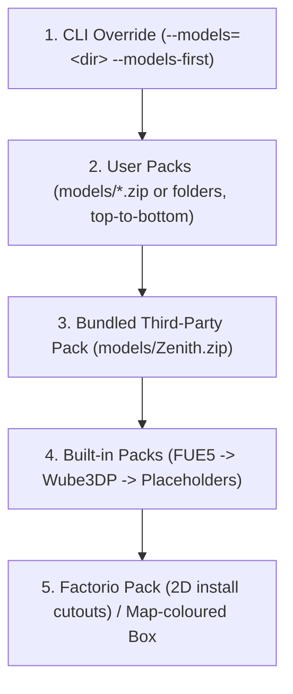

# Making Models for Zenith

Guide for 3D modellers creating assets and packs for Zenith. Complete lookup tables live in [client/assets/models/README.md](../client/assets/models/README.md).

## The look

Models should read like Factorio: match the high-resolution sprites in your install (`data/base/graphics/entity/`, `data/space-age/...`) from Factorio's 45° south-facing camera in proportions, silhouette, colours, and wear. Inspect Factorio's files for reference only—never redistribute Wube's images or sounds inside a pack.

## Every model

### Core rules (format, scale, origin, facing, budget)

- **File & naming:** Binary `.glb` named after Factorio's internal prototype (`assembling-machine-2.glb`, `storage-tank.glb`).
- **Scale & origin:** `1 unit = 1 tile`, centred on the ground footprint at `y = 0`. Give buildings a slight inset so adjacent tiles read separately (belts and walls go edge-to-edge so lines join cleanly).
- **Facing:** Face **north** (Blender `+Y` up export; Godot `-Z`). The client rotates orientations from this. Non-rotating entities (`chest`, `furnace`, `lab`) keep their front facing south.
- **Triangle budget:** Stay within `tools/models/check.py` caps—aim under ~10k tris for typical machines, under ~1.5k for spammed logistics, and up to ~16–20k for major landmarks.

### Materials, PBR & transparency

- **Textures:** Embed optional base-colour, metallic-roughness (glTF green = roughness, blue = metal), occlusion (red channel), normal (OpenGL tangent space), and emission maps on the first UV map (`Closest` filter keeps pixel art crisp; `Linear` smooths). One atlas material per model is cheapest; vertex colours from Blender are overwritten by Zenith's baked weathering data.
- **Shading modes:** Without `"shading": "pbr"` in `pack.json`, Zenith applies Factorio's darker-top light balance and attenuates bare metal to avoid sky-reflection darkening. Set `"shading": "pbr"` for standard glTF PBR lighting (`packs' own shading` setting switches this globally). Keep base colour white on textured materials.
- **Blend modes & culling:** Keep materials **Opaque** wherever possible. Use **Alpha Clip** (double-sided + shadows) for grilles, fences, leaves, and cutouts, and **Alpha Blend** only for true glass. Backface culling is always forced on for Opaque and Alpha Blend faces—give hollow geometry (open pipes) inner walls with outward normals.
- **Emission:** Emission maps glow strictly while the machine is active.

### Moving parts & baked skeletal animations

- **Code-driven `anim_*` nodes:** Keep rigid moving parts as separate child objects pivoted at their rotation/slide axis (`anim_spin_fan`, `anim_spin_drill`, `anim_spin_flywheel`, `anim_turret_head`, `anim_door_n/s`, `anim_hatch_e/w`, `anim_glow_*`, `anim_lit_green/yellow/red`). New kinds require client support.
- **Baked skeletal / clip animation:** Alternatively, bind one skinned mesh to an armature (up to 4 bones per vertex) or animate separate objects in a single looping glTF action:
  - Loops only while the machine works (eases in/out at start/stop).
  - Keep spinning parts under **~5 turns/s** at 24–30+ fps and close every loop on whole turns (`1.0`, `2.0`, …) so it never snaps or strobes.
  - For animated standalone objects (like splitter rollers), key the resting orientation in rotation keys so glTF playback doesn't flatten the object sideways.

## Multi-part & variant entities

| Entity | Required files & rules |
|---|---|
| **Transport belt** | `transport-belt.glb`, `-curve-left.glb`, `-curve-right.glb` (`-curve-left` enters west, exits north). Slats material name containing `belt_surface` scrolls; frame uses `tier_paint` for fast/express/turbo tinting. |
| **Underground belt** | `underground-belt-input.glb`, `-output.glb` (both modelled facing north with hood opening south; client flips exit). |
| **Splitter** | `splitter.glb` (2 tiles wide E–W). Uses `belt_surface`, `anim_*` gears, or `Roller`-named animated parts. |
| **Pipes & heat pipes** | 16 shape files `pipe-<shape>.glb` / `heat-pipe-<shape>.glb` (`straight-vertical`, `corner-up-right`, `t-left`, `cross`, `ending-down`, ...; `up` = north) plus optional `pipe-straight-vertical-window.glb` / `-horizontal-window.glb`. |
| **Walls** | `stone-wall-<sides>.glb` (`pylon`, `n`, `ew`, `es`, `nesw`, ...) + `stone-wall-fill.glb` for `2x2` centers. |
| **Rails (ground & elevated)** | `straight-rail`, `half-diagonal-rail`, `curved-rail-a`, `curved-rail-b` (+ `elevated-*`) in north `<name>.glb` and `<name>-ne.glb`. |
| **Inserters** | Base (`<name>.glb` + optional `-east/-south/-west`) + arm pieces (`inserter-arm-<family>-upper`, `-hand-open`, `-hand-closed` for `basic`, `long`, `bulk`, `stack`). |
| **Directional buildings** | Boiler, steam engine, offshore pump, pipe-to-ground, valves, burner drill, pumpjack, chemical plant, crusher: either 1 north model or all 4 (`<name>.glb`, `-east`, `-south`, `-west`). |
| **Cargo bays & corpses** | `cargo-bay.glb` + edge walls/corners; biter/spitter `<name>-corpse.glb` and `-corpse-1..3`. |
| **Mining drill fluid & pipe covers** | Optional `<drill>-wet.glb` overlay (world-aligned over dry drill) and `pipe-cover.glb` (north edge of connection tile). |
| **Numbered variants** | `<name>-1.glb`, `-2.glb`, `-3.glb` pick deterministically per placed instance. *(Prototypes with numbers in Factorio's name like `assembling-machine-2` remain distinct.)* |
| **Ore fields** | Scattered rock variants (`<ore>-1.glb`, `-2.glb`, ...) or full-tile `<ore>.glb` (`-rich`, `-sparse`). Scattered ores scale across Factorio's 8 richness thresholds (`3`–`14` rocks per tile) unless `"ore_scatter": false` in `pack.json`. |

Electric poles attach wires at Factorio's prototype insulator coordinates (see `client/scripts/world/wires.gd`). Creatures and the character share skinned shader rigs—check with the maintainer before modifying.

## Model packs & trying your models



Drop `.glb` files, folders, or `.zip` packs (no manual unzip needed) directly into `models/` beside `Zenith.exe` (**Model packs → Open folder**), or pass `-- --models=<folder> --models-first`.

### `pack.json` manifest

Place `pack.json` at the pack root (or one subfolder deep):

```json
{
  "name": "My Model Pack",
  "version": "1.0.0",
  "author": "Your Name",
  "licence": "CC BY-NC 4.0",
  "description": "Custom Factorio 3D models.",
  "icon": "assembling-machine-2",
  "shading": "pbr"
}
```

| Key | Purpose |
|---|---|
| `name`, `version`, `author`, `licence`, `description` | Shown on the pack card inside the **Model packs** window. |
| `icon`, `icon_image` | Prototype rendered as thumbnail (or `pack.png`/`icon.png`, custom path, or `"factorio:<path>"`). |
| `shading`, `shading_models` | `"pbr"` or `"factorio"` default, with per-prototype wildcard overrides (`{"transport-belt": "factorio", "iron-ore-*": "pbr"}`). |
| `belt_item_height`, `belt_lane_offset` | Belt surface elevation (`tiles`) and half-lane lateral spacing (default `0.234`). |
| `aliases`, `ore_scatter` | Map custom filenames (`{"coal-ore": "coal"}`); set `"ore_scatter": false` to disable scattered ore placement. |
| `tiles`, `decoratives` | Per-pack overrides for custom tile scales/normals (`normal_flip_x`, `roughness`, etc.) and decorative placement (`scale`, `grass_style`, `hide`). |

### Optional pack folders

| Subfolder | Contents & notes |
|---|---|
| `items/` | Small belt/ground/hand item `.glb`s (`items/iron-plate.glb`), ~0.25 tiles wide at `y = 0`, separate from building models. |
| `icons/` | Custom 64/128 px UI PNGs (`icons/<name>.png` or `icons/<kind>/<name>.png`). |
| `sounds/` | Ogg Vorbis replacements matching Factorio paths (`sounds/base/sound/walking/grass-3.ogg`, `sounds/<mod>/...`). |
| `tiles/` | Seamless PNG/WebP/JPEG tile albedos + optional `-normal`, `-height`/`-bump`, `-roughness` maps (`tiles/dirt-1-normal.png`). |
| `decoratives/` | Custom 3D `.glb`/`.gltf` decorative models or 2D sprites (`decoratives/<name>.glb` or numbered folder; toggled by Settings → *3D decorative models*). |

> [!IMPORTANT]
> **Copyright safety guard:** Zenith compares files `> 1 KB` against the player's local Factorio install at startup. Any pack containing copied Factorio textures, icons, or audio is blocked from loading and flagged red in the Model packs window.

## Checking & fixing exports

From a source checkout, validate naming, footprint, origin, facing, and budgets:

```bash
python3 tools/models/check.py <name>       # e.g. fue5/stone-furnace
python3 tools/models/review.py <name>      # windowed in-client comparison shots
```

To normalize exports non-destructively using a repeatable rules file (renaming, centering origins, duplicating pipe pieces, cleaning opaque/emission/Glass blend flags, recolouring, keeping rest turns on animated parts, or double-siding open pipe ends):

```bash
python3 tools/models/fix_pack.py <export_dir> <out_dir> [--fixes tools/models/fixes/vasillo.json]
```

## Improving models over time & licence

Check [ASSET-INVENTORY.md](ASSET-INVENTORY.md) for families needing sprite-matching refinements, coordinate before replacing existing models, and test in-game under both default camera and `F6` Factorio view. Code is **GPL-3.0**; contributed or bundled model packs can retain their own open/non-commercial licence via `pack.json` and [CREDITS.md](../CREDITS.md) (such as **FUE5** `CC BY-NC-SA 3.0`, **Wube3DP** `CC BY-NC`, and Vasillo's `Zenith.zip`).
