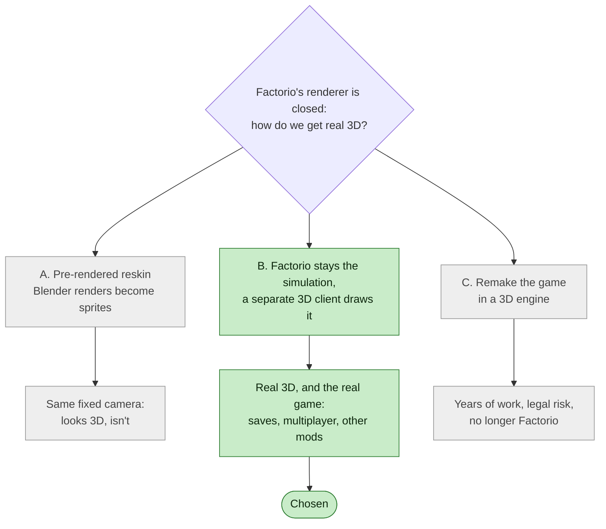
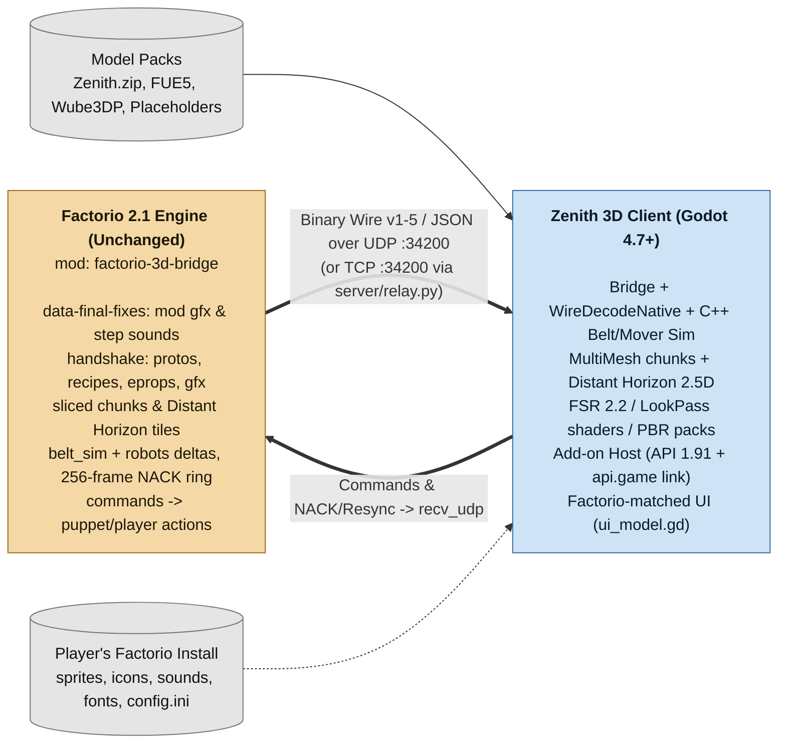
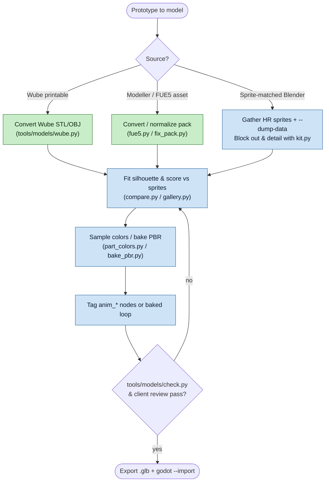

# Zenith: Project Plan

**Goal:** Play a real running Factorio 2.1 game in 3D, with an angled camera close to the character and a 3D model for every entity. Factorio remains the sole simulation; Zenith renders it and sends input back.

Model-by-model asset status lives in [ASSET-INVENTORY.md](ASSET-INVENTORY.md).

---

## 1. The constraint that shapes everything

Factorio's Lua API cannot control 3D meshes, custom shaders, or the 3D camera. That leaves three routes:



Factorio 2.0.59's `helpers.send_udp` / `recv_udp` (`--enable-lua-udp <port>`) unlocks **Route B** cleanly: belts, fluids, trains, biters, saves, multiplayer, and Factorio mods stay untouched inside Factorio while the client handles 3D rendering and UI.

---

## 2. Architecture



**Why Godot 4.7+:** MIT-licensed, clean glTF/PBR workflow, `MultiMeshInstance3D` instancing, native AMD FSR 2.2 support, and GDExtension C++ support (`client/native/belt_sim/`) for hot loops.

**Two play modes:**

1. **Headless server (primary):** The menu launches headless Factorio (`server/`), taking over the save's character (`takeover.lua`) and rendering every Factorio GUI in-client. Press `Ctrl+F9` to inspect or join in Factorio's window.
2. **Hybrid single-player:** Connects to an open Factorio window launched with `--enable-lua-udp 34200` and controls the player's active character directly.

---

## 3. Verified API & UDP transport notes (Factorio 2.1.x)

| Need | Factorio Lua API |
|---|---|
| Stream state & receive commands | `helpers.send_udp`, `helpers.recv_udp`, `on_udp_packet_received` |
| Encode / dump | `helpers.table_to_json`, `helpers.json_to_table`, `helpers.write_file` |
| World & mod data | `surface.find_entities_filtered`, `find_tiles_filtered`, `prototypes.mod_data` (`LuaModData.get`) |
| Live change events | Built/mined/died/destroyed/rotated/flipped/tile/chunk events |
| Belts, arms & vehicles | `belt_shape`, `transport_line.get_detailed_contents()`, `held_stack_position`, `orientation` |
| Machines & atmosphere | `status`, `is_crafting()`, `crafting_progress`, `daytime`, `darkness` |
| Character control | `walking_state`, `mining_state`, `build_from_cursor`, `rotate`, `opened` |

Key transport constraints: Factorio UDP listens on `127.0.0.1` (`server/relay.py` handles LAN TCP bridging); packets arrive asynchronously via input actions; batching + Binary Wire `v1–5` (`0xF3`) keep datagrams under `65,507` bytes; reliable sequence numbers (`r`) use a `256`-frame retransmit ring (`nack`) backed by chunk `resync` ([PROTOCOL.md](PROTOCOL.md)).

---

## 4. Conventions (fixed)

- **Scale & axes:** `1` Factorio tile = `1` Blender unit = `1` Godot unit. Factorio `(x, y)` maps to Godot `(x, height, y)`. North = Blender `+Y` / Godot `-Z`.
- **Facing & origin:** Models face **north**, origin at ground footprint centre. Client rotates by `yaw = -direction / 16 * TAU` (vehicles `-orientation * TAU`).
- **Model lookup:** `client/assets/models/packs/<pack>/<prototype>.glb` (external overrides in `models/`), falling back to Factorio 2D sprite cards or selection-box blocks.
- **Animation:** Either `anim_*` cut-out objects moved by shader state (`anim.gd`) or a single baked skeletal glTF action (`client/assets/models/README.md`).

---

## 5. Where it stands

Public `0.2.1` is out and `0.3.0` is the active dev-channel pre-release:

| Area | Status |
|---|---|
| **UDP bridge & binary wire** | Built & live-verified: Binary Wire `v1–5`, `nack` ring, `budget`/`rate` throttling, `server/relay.py` LAN TCP relay |
| **World & simulation** | Headless + hybrid loops, C++ `BeltSimNative` / `WireDecodeNative` (`11`-module GDExtension), `rb` robot sim, `sx` splitter hints |
| **Rendering & views** | MultiMesh chunks, GPU shaders, **Distant Horizon** (to `512` chunks), **AMD FSR 2.2**, per-pack PBR shading, fitted sun shadows |
| **3D models & packs** | **`811` built-in `.glb` files** across `Placeholders` (`575`), `FUE5` (`142`), and `Wube3DP` (`94`), plus `198` 3D items, pack-supplied 3D/2D decoratives, and optional Vasillo PBR `Zenith.zip` |
| **UI & modding** | Factorio 2.1 key parity, all core screens, `gfx` mod sprites/icons/tiles, **Add-on API `1.91`** (`4` in-repo add-ons in `addons-src/` + `Zenith-Cinematic-Camera` & `Terrain-Elevation`) |

Remaining polish sits in `STATUS.md` and `PROGRESS.md` (dense forest GPU cost, UI last-mile differences, FUE5 missing glow/moving parts, and overhaul mod testing).

---

## 6. Converting the 2D sprites into 3D models

### 6.1 Scope & exclusions

Factorio + Space Age + Elevated Rails cover ~`190` model families (`811` built-in `.glb` variants/pieces tracked in [ASSET-INVENTORY.md](ASSET-INVENTORY.md)). Terrain tiles, item icons/cards, particle sprite sheets (`weapon_fx.gd`), and shader-deformed remnants are handled procedurally rather than standalone entity `.glb`s.

### 6.2 Model pipeline & workflow

**Source priority:** Convert Wube's 3D printables (`wube.py`) where available; otherwise build procedural Blender scripts (`tools/models/`) matched to Factorio HR sprites, or adapt/pack modeller assets (`fue5.py`, `fix_pack.py`).



**Triangle budgets (LOD0):** Spammed logistics `<= 1.5k` (2 LODs); common machines `<= 10k` (2 LODs); landmarks `<= 40k` (2–3 LODs); creatures `<= 8k` (`<= 40` bones); trees & rocks `<= 3k` (2 LODs + impostor).

---

## 7. Risks and mitigations

| Risk | Mitigation |
|---|---|
| Lua UPS cost on megabases | Event deltas, focus-radius culling, sliced `budget.lua`, client `rate` governor (`60 UPS` hold), `C++` belt/robot offloading |
| Packet loss or datagram caps | Binary Wire `v1–5` under `60 KB`, `256`-frame `nack` ring + `resync`, TCP `relay.py` over LAN |
| Multiplayer desync | Pure deterministic `storage` updates in ticks/events; input travels via Factorio input actions |
| Legal / IP boundaries | Never redistribute Factorio assets; load sprites/sounds/fonts from player install at runtime; GPL-3.0 code + upstream NC credits ([CREDITS.md](../CREDITS.md)) |

---

## 8. Repository layout

```text
zenith/
├── README.md, ARCHITECTURE.md, MODDING.md, STATUS.md, PROGRESS.md
├── mod/factorio-3d-bridge/   # Bridge mod (Lua + data-final-fixes mod graphics)
├── client/                   # Godot 4.7+ client, packs/, native C++ GDExtension (native/)
├── addons-src/               # In-repo add-ons (shaders, weather, enemies, sprint)
├── server/                   # Headless Factorio launchers (.ps1/.sh) + LAN relay (relay.py)
├── tools/                    # check.py, mock_server.py, live_check.py, models/, release/
└── docs/                     # Guides, PROTOCOL.md, SWITCHES.md, ASSET-INVENTORY.md, plans
```
