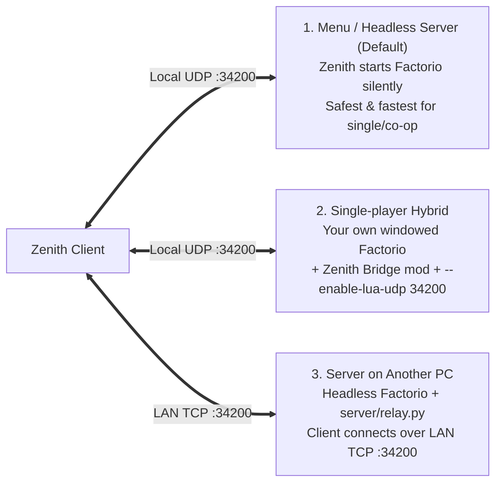

# Zenith: Player's Guide

Zenith lets you play your real Factorio 2.1 save in 3D with an angled camera close to your character. Factorio itself still runs the simulation; a bridge mod streams the world to the **Zenith client**, which renders it in 3D and sends your inputs back.

This guide covers playing Zenith. For developer flags and testing, see [RUNNING.md](RUNNING.md), [SWITCHES.md](SWITCHES.md), and [ARCHITECTURE.md](../ARCHITECTURE.md).

## What you need

- **Factorio 2.1** (Space Age is optional). Zenith reads sprites, icons, sounds, and fonts straight from your install at runtime.
- **Zenith:** Either a release zip (`Zenith-<version>-windows.zip` or `-linux.zip`) or [Godot 4.7+](https://godotengine.org/download) running from this repository.

## Installing

**From a download:**

1. Unzip anywhere writable (e.g. your Documents folder). Worlds, server data, and settings live in your user folder (`%APPDATA%\Godot\app_userdata\Zenith` on Windows, `~/.local/share/godot/app_userdata/Zenith` on Linux), so updates keep your saves and config. *(The Linux build has not been field-tested yet.)*
2. Run `Zenith.exe` (Windows) or `Zenith.x86_64` (Linux). If Zenith cannot find your copy of Factorio automatically, set its folder in **Settings → Factorio install**.

**From the repository:**

1. Run `godot --headless --audio-driver Dummy --path client --import` once to import 3D models.
2. Start the client with `godot --path client`.

## Ways to play & first game

From the main menu:

- **Single player → New game:** Uses Factorio's map generator and starts a local headless server automatically.
- **Single player → Load game:** Copies your selected save into Zenith's own folder (never modifying your original save) and launches headless Factorio.
- **Multiplayer → Host new / saved game:** Starts a server friends can join with regular Factorio while you play in 3D.
- **Multiplayer → Connect to address:** Joins an already-running bridge (`127.0.0.1:34200`) or a LAN relay (`<host-ip>:34200`).
- **Single player → Single-player (hybrid):** Attaches to your own open Factorio window (requires *Zenith Bridge* installed and `--enable-lua-udp 34200` in Factorio's launch options).

<!-- dev -->
**Performance test** *(development builds only — omitted from public downloads)* runs a ~3-minute automated benchmark from the main menu without touching your saves or settings and writes a report file you can attach to feedback; see [PERFORMANCE-TEST.md](PERFORMANCE-TEST.md).

<!-- /dev -->

## Playing

### Controls & camera

Factorio's normal keys apply (`WASD` move, `Right click` mine—including vehicles/trains with cargo inside, `Left click` build/open, `E` inventory, `R` rotate, `Q` pipette, `F` pick up items, `T` tech, `M`/`Tab` map, `Enter` enter/exit vehicles, `` ` `` console).

When Zenith detects Factorio's `config.ini`, it follows Factorio 2.1's bindings by default (turn on **Settings → Controls → Zenith 0.2.2's keys** to restore the older key set). Press **F1** at any time for the live grouped control list, or rebind everything in **Settings → Controls**.

| Input | Camera action |
|---|---|
| **Mouse wheel** | Zoom in / out |
| **Middle mouse drag** | Orbit and tilt around your character |
| **`,` / `.`** | Rotate camera 90° |
| **Page Up / Page Down** | Adjust tilt |
| **F5** | Toggle **First Person** (direct crosshair aim, build on sides or ground within reach) |
| **F6** | Toggle **Factorio's 2D angle** |
| **F7** | Toggle Perspective / Orthographic for the active view |
| **F8** | Free camera *(Cinematic camera add-on; `F11` hides HUD, `F12` saves screenshot)* |
| **Ctrl+F9** | **Show in Factorio** — switch to Factorio's window (and back via `Ctrl+F9` or Zenith's gear button) |

### World views & gameplay tools

- **Alt-mode (`Alt`):** Shows machine recipes, filters, fluid arrows, pump flow, and cargo wagon contents (`Settings → Interface → Alt-mode` configures each layer).
- **Entity info & links:** Hovering buildings shows status, recipes, modules, electricity usage, and roboport links; on Space Platforms, the platform panel shows route, speed, mass, and **Drop to a planet**.
- **Launching Zenith from Steam/Factorio:** Copy the launch line from **Settings → Other → Copy launch options** into Steam's Factorio Launch Options (after running Zenith once) so `Ctrl+F9` inside Factorio can launch Zenith on demand.

## Playing with mods

Because real Factorio runs underneath, mods' recipes, machines, research, and planets work as authored. Modded items, ground tiles, plants, rocks, and step sounds render from the mods' own files; modded buildings appear as animated or still Factorio sprite cards (or boxes if no sprite exists).

| Mod type | Examples | Headless Server | Hybrid Mode |
|---|---|---|---|
| New content / data tweaks | Space Exploration, Krastorio 2, Squeak Through | **Yes** | Yes |
| Player-triggered bonuses/scripts | Far Reach, auto-fillers | Limited *(bridge uses script character)* | **Yes** |
| Custom mod GUIs & hotkeys | Factory Planner, Helmod, Informatron | Use `Ctrl+F9` *(Informatron buttons work)* | Best via `Ctrl+F9` *(Windows auto-click experimental)* |

- **Recommended:** Use **Headless Server** (via **Mods** window or **Load game → Sync mods with save**) for speed and stability. Use **Hybrid** only when a mod specifically requires a real logged-in player or custom Factorio GUI. Running both windows side by side costs ~1 UPS on dense bases and shares CPU/GPU with Factorio.
- Toggle experimental **Show mods' windows** in **Settings → Interface** if you want Zenith to mirror mod windows (`Act as the player for other mods` map setting controls whether player events fire).

## Settings worth knowing

Settings live in **Settings** (split into *Graphics*, *Sound*, *Controls*, *Interface*, *Other*, *Mod settings*, *Camera*, *Factorio install*, and *Add-ons*). Defaults mirror your Factorio `config.ini` where applicable.

### Display & upscaling

- **Resolution & Render scaling:** Windowed sets window dimensions; fullscreen renders the 3D scene at the chosen resolution and scales to fit your monitor while keeping UI crisp (`Game render scaling` multiplies resolution).
- **Upscaling & Anti-aliasing:** Choose **Bilinear**, **FSR 1.0**, or **AMD FSR 2.2 (Temporal)** plus an **Upscaler sharpness** slider (`FSR 2.2` performs its own temporal anti-aliasing and greys out manual AA; orthographic F6/map views fall back smoothly). Outside FSR 2.2, **SMAA** keeps edges sharp while **MSAA** is unavailable under full-screen shader looks like *Cinematic shaders*.

### View distance & Distant horizon

- **View distance & Distant horizon:** Control full 3D loaded chunks near you alongside **Distant horizon**, which streams cached 2.5D terrain, water, trees, and factory silhouettes far toward the horizon (with configurable detail, LOD dropoff, night lamp/furnace glow, and wide-screenshot mode). You can optionally toggle both sliders into one unified **Render distance** bar.
- **Level of detail:** Controls when far entities simplify; higher resolutions scale threshold distances appropriately so detail doesn't collapse prematurely on 4K displays.

### Lighting & shading

- **Look:** Switch between **Factorio** (sprite-matched lighting, shadows, and planetary colour grading), **Classic Zenith**, or add-on looks like **Cinematic shaders** (bloom, soft shadows, haze, depth effects, real sunrise/sunset).
- **Packs' own shading:** Lets packs declaring PBR in `pack.json` (like Vasillo's `Zenith.zip` and adapted FUE5/Wube3DP PBR) render with full roughness/metal/normal maps, or forces uniform Factorio lighting across all packs.
- **Shadows, Ambient occlusion & Contact shading:** Sun shadows range from `Off` to `Ultra` (also controlling belt-item shadow range). **Ambient occlusion (SSAO)** adds tight corner shading in `High`/`Ultra` and fades cleanly at zoom distance (~0.7 ms GPU up close). **Contact shading** grounds machines and belts softly against the terrain.

### Performance & belts

- **Preset & Recommended:** Presets (`Low`–`Ultra`) tune shadows, distances, AO, and clouds together; **Recommended** benchmarks your hardware for 6 seconds in-game and selects the best 60 UPS/FPS preset.
- **Hold the game at 60 UPS:** Automatically dials back update rates (`rate` 1–3), distances, and optionally frame cap when a megabase drops below ~57 UPS, displaying a clickable performance icon top-left *(hide via Interface → Performance warnings)* without overwriting your saved settings.
- **Merge far buildings & Merged materials:** Combines distant chunks into single low-draw meshes (excluding trees/ores/nests); **Merged materials** reduces CPU draw calls per model at a slight GPU trade-off after restart.
- **Items on belts & Step onto belts:** Independently set **Belt item distance**, **Moving belt items** (*Automatic* budgets bridge cost), and **Items in 3D** (*All*, up to 20k, or *Icons only*). **Step onto belts** smoothly lifts your character model over belts/splitters without altering collisions.

### Camera, controls & UI

- **Camera tab:** Sets starting camera angle, Perspective/Orthographic defaults, **Furthest zoom** (`60–400` tiles), map zoom-out threshold (`80–480` tiles), and **Add-ons' camera motion** intensity (`0–100%` for motion comfort).
- **Bridge settings (`Settings → Mod settings`):** Adjust server tick budgets, streaming radius, and active `/f3d-player` assignment without restarting.
- **UI scale & Audio:** Adjust UI scaling live (`Ctrl+=` / `Ctrl+-` / `Ctrl+0`), and hear per-tile Factorio footsteps (or pack replacement sounds) across terrain, ore, rails, and plants.

<!-- dev -->
## The debug menu

*(Development builds and source runs only — omitted from public downloads along with its keybinding.)*

Press **Ctrl+F12** in-game (also usable while in free camera or `F11` hidden HUD) to open the debug overlay:

- **Time:** Jump time of day, freeze daylight, change speed, or pause/resume (admin-restricted in multiplayer).
- **Benchmarks:** Run standardized standing, lap, flyover, and zoom tests comparing FPS, GPU time, draw calls, and UPS against your previous run.
- **Tests:** Live frame-time graphs, chunk borders, `/f3d-selftest`, pack provenance, and test teleport spots.
- **Updates:** Visualizes live bridge packets on the ground (chunks, entity deltas, belt reads, inserters, power, pending queues).

<!-- /dev -->

## Model packs

Zenith resolves models through stacked packs (highest pack in **Selected** wins for each prototype):

1. **Vasillo's Zenith pack** *(when bundled as `models/Zenith.zip`)* — textured PBR logistics, belts, inserters, rocks, and ores.
2. **FUE5 (Adapted)** — textured FUE5 fan-remake models converted to Zenith's scale with PBR support.
3. **Wube3DP (Adapted)** — scaled, coloured models converted from Wube's official 3D print files.
4. **Placeholders** — built-in blender models covering Nauvis and Space Age entities (`198` 3D item meshes; custom packs can also add 3D `.glb` or 2D `decoratives/`).
5. **Factorio** — 2D sprite cutouts and item icons read live from your install (never shipped in Zenith).

Drop third-party `.zip` packs, folders, or loose `.glb` files into `models/` beside `Zenith.exe` (**Open folder** in the Model packs window opens it). Any pack shipping copies of Factorio's copyrighted assets is rejected automatically.

In the **Model packs** window (or a building's **Model** title-bar button), you can toggle/reorder packs, inspect spinning 3D previews, override individual entities (`This one` / `Every one`), or start with `-- --no-custom-models` to isolate built-in packs.

## The main menu's backdrop

In any loaded save, frame your factory and click **Esc → Use this view as the menu backdrop**. Zenith captures nearby `5x5` chunks and ~10 seconds of live belt/train/biter motion into `user://backdrops/` (your character omitted) and plays it behind the main menu using your active model packs. Manage saved backdrops from **Menu backdrop** on the main menu, or pass `-- --menu-backdrop=default` to launch with the built-in scene once.

## Add-ons

Add-ons extend Zenith's camera, visuals, weather, and UI via GDScript without touching Factorio's simulation unless paired with a companion Factorio mod (`api.game`). Writing one: [ADDONS.md](ADDONS.md).

- **Installed add-ons live off by default** because add-ons run full GDScript code with your PC permissions. Switch on only add-ons you trust in the **Add-ons** menu. Drop add-on `.zip`s or folders into `%APPDATA%\Godot\app_userdata\Zenith\addons\` (or `addons/` beside `Zenith.exe`).
- **Bundled `0.3.0` add-ons:** **Cinematic camera** (on — free cam, paths, recording), **Cinematic shaders** (on — filmic post-processing look), **Immersive Weather** (on — wind, 3D rain, puddles, lightning on Nauvis), **Immersive Enemies** (on — ragdolls, gore, acid), and **Terrain Elevation** (on — 3D hills). *(Note: avoid manually minimizing Zenith while background-recording video with Cinematic camera, or frames stop drawing.)*

## Several players & servers on another PC

- **Multiplayer (standard Factorio):** Host from Zenith's menu so Factorio friends connect normally on port `34197` and see your character.
- **Multiple 3D clients:** Start additional Zenith instances on the same PC to share one bridge server (`34202+`), each driving its own character. Admins can run `/cheat` and `/f3d-*` console commands.
- **Dedicated server on another PC:** Because Factorio Lua UDP only talks on `127.0.0.1`, run `python3 server/relay.py` beside your server (`--rcon-port 34198` if you want Zenith pause/save), allow TCP `34200` for your LAN subnet **only** (never expose to the internet), and connect to `<server-ip>:34200`. Your PC still needs Factorio installed locally for sprites and sounds. See [RUNNING.md](RUNNING.md#server-on-another-pc).

### Checking for a new version

**Check for updates** (bottom left of the main menu) asks GitHub's public releases page of Zenith's own repository whether a newer release exists, and tells you. It is one HTTPS request with only the usual headers (`Accept`, and `User-Agent: Zenith/<your version>`): nothing about you or your PC is sent, no id, nothing is downloaded or installed (**Download** just opens the releases page in your browser). **Nothing is requested until you click it**, unless you turn on **Auto check on open** (in that popup or Settings > Interface; off by default): then the main menu asks at most once in 6 hours and says something only when a newer version exists (**Don't show again** keeps that version quiet). `--update-check=off` removes the button and every request; `--update-check=test` shows the popup with a made-up newer version and no request. A build with the testing tools (a dev build, or `--dev-tools`) has no button.

## When something goes wrong

| Problem | What to try |
|---|---|
| `"No answer from the bridge"` on dedicated server | Set `"auto_pause": false` in `server-settings.json`, pass `--enable-lua-udp 34200`, and verify bridge mod is active via `/c __factorio-3d-bridge__ rcon.print(tostring(game.tick_paused))`. |
| `"Waiting for Factorio on 127.0.0.1:34200"` | Confirm Factorio started with `--enable-lua-udp 34200` and check `/f3d-status` in Factorio's console. |
| `"No relay answers"` on another PC | Check `python3 server/relay.py` is running, LAN firewall allows TCP `34200`, and your client IP matches `--allow`. |
| Menu server fails to start | Read the Factorio log excerpt in the popup, confirm **Settings → Factorio install**, and close duplicate servers sharing `server-data`. |
| `"Can't open UDP port 34201"` | Ports `34201`–`34208` are all occupied; close extra Zenith clients or mock tests. |
| Flat ground, missing icons, or no audio | Set Factorio's path in **Settings → Factorio install**. |
| Stutters or low FPS on huge bases | Click **Settings → Graphics → Recommended**, keep **Hold the game at 60 UPS** on, or reduce View/Distant Horizon/Belt item distances. |
| Other bridge issues | Run `/f3d-selftest` in Factorio or check [TROUBLESHOOTING.md](TROUBLESHOOTING.md#troubleshooting). |

Use **Report a bug** in the main or Esc menu to zip recent client/server logs (note: logs may include your OS username in paths) and open GitHub's issue form.

Zenith is an unofficial fan project, not made, endorsed, or supported by Wube Software. Factorio is theirs.
